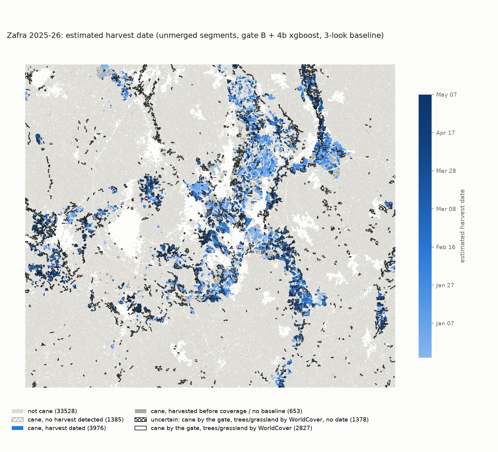

# Zafra Radar Research

Research library: NISAR L-band toolkit for per-field sugarcane harvest detection. Built
before NASA Space Apps 2026 to learn the data; the hackathon application is a separate
repository (link to be added).

[](https://github.com/JuanToledo23/zafra-radar-research/actions/workflows/ci.yml)
[](LICENSE)
[](#data-licence)
[](pyproject.toml)

Maintained by Juan Toledo.

The library dates the harvest of individual sugarcane fields from NISAR L-band radar
(GCOV backscatter and GUNW interferometric coherence). Every date comes with its
uncertainty and is checked against satellite fire detections, Sentinel-2 and a land-cover
map. It was developed on the supply area of the Ingenio Emiliano Zapata (Zacatepec /
Jojutla, Morelos, Mexico) and applied unchanged to Ribeirão Preto, Brazil.

## The problem

In the sugarcane belt of Morelos, Mexico, the harvest season (*zafra*) runs from November
to May, and cane is usually burned before it is cut. There is no field-level record of when
each field was harvested or whether fire was involved (the public harvest reports are per
mill [27], and harvest news is per region [34]), and field visits do not scale. Optical
satellites lose fields to cloud and smoke and see a drying canopy before the cut. Satellite
fire detections (VIIRS) are coarse and brief: within 200 m and the week before, they catch
only 8.7 % of the harvests dated here
([VALIDATION](docs/VALIDATION.md#known-limitations)).

## Quickstart (60 seconds, no downloads)

```bash
git clone https://github.com/JuanToledo23/zafra-radar-research.git
cd zafra-radar-research
make setup    # .venv with the library + download/ee/dev extras (uses uv if installed)
make test     # ~115 tests on synthetic data and the committed results
```

Then browse what the pipeline produced, without running it:

- [`results/`](results/): one folder per exercise. Start with
  [`results/4e/area_summary.json`](results/4e/area_summary.json) (Morelos area map) and
  [`results/5_brazil/transfer.md`](results/5_brazil/transfer.md) (transfer to Brazil).
- [`docs/figures/`](docs/figures/): the harvest maps and validation figures.
- [`docs/README.md`](docs/README.md): reading order for the method and validation documents.

Python 3.11 or 3.12. `rasterio`, `pyproj` and `pyogrio` wheels bundle GDAL/PROJ. On macOS,
`xgboost` needs the OpenMP runtime (`brew install libomp`). **Install editable from a
clone** (`pip install -e .`): the scripts read `configs/`, `data/` and `results/` relative
to the checkout, so a plain wheel install is not supported yet.

## How it works

1. **Data.** NISAR L2 GCOV backscatter (HH, HV) and L2 GUNW coherence, Sentinel-2,
   VIIRS fires, ESA WorldCover, per site from `configs/<site>.yaml`
   ([METHODS 1](docs/METHODS.md#1-data-and-sites)).
2. **Field polygons.** Felzenszwalb segmentation of the Sentinel-2 NDVI history
   (39 542 segments on Morelos); SAM was tried and rejected
   ([METHODS 2](docs/METHODS.md#2-field-polygons-reference-fields-and-segmentation)).
3. **Cane gate.** A logistic regression on NDVI phenology gives P(cane) per polygon; the
   optical gate (B) is delivered on both sites, and the radar-only gate (A) is always
   computed alongside as radar evidence ([METHODS 3](docs/METHODS.md#3-cane-gate)).
4. **Harvest detector.** xgboost on per-look radar features (HV change, coherence) dates the
   cut on gated cane polygons ([METHODS 4-5](docs/METHODS.md#4-radar-series-and-features)).
   A scene-quality check flags corrupt acquisitions; excluded ones are listed in the site
   config.
5. **Baseline rule and flags.** A date is kept only after 3 standing looks in its orbit;
   status, confidence and the WorldCover flag are added
   ([METHODS 6](docs/METHODS.md#6-baseline-rule-status-and-flags)).
6. **Alerts and summaries.** Six deterministic alert rules and a verified per-polygon
   summary in Spanish and English ([METHODS 7-8](docs/METHODS.md#7-alert-rules)).

## Results at a glance

| site | measure | result | checked against | source |
|---|---|---|---|---|
| Morelos | harvest date error (xgboost, out of fold) | median 3.5 d; 24 of 26 fields within ±12 d (rule: 19.2 d; ratio test, both orbits: 11.5 d) | Sentinel-2 NDVI harvest windows of 26 cane fields | [`results/4b`](results/4b/comparison.md) |
| Morelos | cane gate accuracy (leave-one-field-out) | 37/38 optical (partly circular); 34/38 radar only | NDVI labels of 38 fields | [`results/4c`](results/4c/comparison.md) |
| Morelos | area dated, zafra 2025-26 | 3 976 of 6 014 cane segments; 6 867 of 9 943 ha | – | [`results/4e`](results/4e/area_summary.json) |
| Morelos | weekly harvests vs VIIRS fires within 200 m of cane | r = 0.71 (same week) | VIIRS active fires | [`results/4e`](results/4e/area_summary.json) |
| Morelos | HV drop at harvest, L- vs C-band (26 cane fields) | NISAR HV −2.5 dB (asc) / −1.9 dB (desc); Sentinel-1 VH −2.2 to −2.7 dB | Sentinel-2 NDVI harvest windows | [`results/9`](results/9/l_vs_c.md) |
| Morelos | map vs official mill data, Ingenio Emiliano Zapata 2025-26 | gated cane 9 943 ha vs 9 565 ha harvested (AOI ≠ supply area); dated 6 867 ha; weekly r = 0.44 (lag 0), 0.27 (+1), −0.01 (+2) | CONADESUCA weekly and final reports | [`results/10`](results/10/official_comparison.md) |
| Brazil | cane gate (optical, unchanged Morelos model) | precision 77.8 %, recall 51.2 % by area (radar gate A: 74.9 % / 46.9 %) | MapBiomas 2024 land cover | [`results/5_brazil`](results/5_brazil/validation.md) |
| Brazil | harvest date error (unchanged Morelos detector) | median 2.5 d; 37 of 40 sampled segments within ±12 d | NDVI rule on the local Sentinel-2 stack | [`results/5_brazil`](results/5_brazil/validation.md) |
| Brazil | area dated, safra 2026-27 (radar from 2026-06-22) | 2 776 of 12 210 cane segments; 12 413 of 42 491 ha (corrupt 07-18 scene excluded) | – | [`results/5_brazil`](results/5_brazil/transfer.md) |

None of these is accuracy against field visits: the references are optical or land-cover
maps, or mill-level statistics (see [Validation](#validation)).



*Estimated harvest date per cane segment, Morelos zafra 2025-26 (darker = later). Outlined
segments are cane by the gate but trees or grassland by ESA WorldCover.*

## Validation

The harvest detector beats the classic radar change detectors on the 26 labelled fields
(3.5 d vs 11.5-19.2 d median error) but fires on almost every non-cane field, which is why
the cane gate runs first (non-cane false alarms 11/12 → 1/12). Area-wide, the weekly
harvest counts and the weekly fires near cane rise and fall together (r = 0.71). The one
grower report for 2025-26 (field p36) disagrees with every satellite signal by 12-17 days;
the 2024-25 report agrees. Full tables, figures and the p36 ground-truth
check: [docs/VALIDATION.md](docs/VALIDATION.md).

## Getting the data

Nothing under `data/` or `outputs/` is versioned, except the reference field polygons and
labels (`data/fields/`, `data/labels/`) and the web tile index. Credentials go in `.env`
(`cp .env.example .env`):

| variable | for | where |
|---|---|---|
| `EARTHDATA_USERNAME`, `EARTHDATA_PASSWORD` | NISAR from ASF DAAC | https://urs.earthdata.nasa.gov |
| `FIRMS_MAP_KEY` | VIIRS active fires | https://firms.modaps.eosdis.nasa.gov/api/map_key/ |
| `EE_PROJECT` | Sentinel-1/2, WorldCover via Earth Engine (`.venv/bin/earthengine authenticate`) | your Google Cloud project |
| `ANTHROPIC_API_KEY` | optional LLM summaries (template fallback without it) | https://console.anthropic.com |

**Disk budget.** A NISAR GCOV scene is about 7 GB. Morelos uses 30 GCOV scenes (two orbits)
plus GUNW pairs; Brazil uses 26 files (142.7 GB). Both sites, with the Sentinel-2 stacks
and intermediate outputs, take about 375 GB. Downloads resume and are size-checked
(`scripts/00_download_nisar.py`).

## How to run each stage

Morelos is the default site; add `--site brazil` for the second site. Each script's
options are in its docstring (`--help`). Run from the repository root with
`P=.venv/bin/python`.

| script | stage | output |
|---|---|---|
| `00_download_nisar.py` | NISAR GCOV / GUNW search and download (ASF) | `data/nisar/` |
| `00_download_firms.py` | VIIRS active fires for the site bbox | `data/firms/` |
| `01_inspect_gcov.py` | *learning exercise:* look inside a GCOV file | console |
| `02_field_backscatter.py` | *learning exercise:* HH / HV for one field, one scene | console |
| `03_compare_two_scenes.py` | *learning exercise:* one field between two dates | console |
| `03_timeseries.py` | *learning exercise:* full-season HV/HH series per field | `outputs/` |
| `04_detect_harvest.py` | *learning exercise:* rule baseline and intensity-ratio test | `outputs/` |
| `05_fires_per_field.py` | VIIRS fires per reference field | `data/fires/` |
| `06_optical_validation.py` | radar harvest windows vs Sentinel-2 NDVI | `outputs/` |
| `07_label_fields.py` | NDVI labels and harvest windows of the reference fields | `data/labels/` |
| `08_multisignal.py` | GCOV asc / desc and GUNW coherence series of the reference fields | `data/features/` |
| `09_p36_ground_truth.py` | ground-truth check of p36 and a harvest-front test | `outputs/front/` |
| `10_harvest_classifier.py` | multi-signal features and the trained harvest detector | `results/4b` |
| `11_cane_gate.py` | cane / non-cane gate and the gated detector | `results/4c` |
| `12_s2_images.py` | Sentinel-2 and WorldCover over the AOI | `data/s2/` |
| `13_field_segmentation.py` | Felzenszwalb segmentation (SAM variant optional) | `results/4d` |
| `14_area_harvest_map.py` | scene quality, gate, detector, baseline rule over every segment | `results/4e`, `results/5_brazil` |
| `15_merge_fragments.py` | merged layer and slim GeoJSON | `data/results/` |
| `16_transfer_validation.py --site brazil` | transfer validation without ground truth | `results/5_brazil` |
| `17_field_summaries.py` | alert rules and per-field summaries | `results/6` |
| `18_web_rasters.py` | NISAR backscatter and change COGs and XYZ tiles | `data/tiles/`, `results/9` |
| `19_l_vs_c.py` | Sentinel-1 series and L- vs C-band drop at harvest | `results/9` |

The delivered pipeline, in order:

```bash
P=.venv/bin/python
$P scripts/00_download_nisar.py --download            # GCOV ascending (~7 GB per scene)
$P scripts/00_download_nisar.py --product GUNW --track 19 --frame 11 --download
$P scripts/00_download_nisar.py --direction DESCENDING --track 113 --frame 79 --download
$P scripts/00_download_firms.py
# reference fields (Morelos only): fires, NDVI labels, radar series, detector, gate
$P scripts/05_fires_per_field.py
$P scripts/07_label_fields.py
$P scripts/08_multisignal.py
$P scripts/10_harvest_classifier.py   # -> results/4b
$P scripts/11_cane_gate.py            # -> results/4c
# area-wide, any site
$P scripts/12_s2_images.py            # Sentinel-2 and WorldCover over the AOI
$P scripts/13_field_segmentation.py   # -> results/4d
$P scripts/14_area_harvest_map.py     # gate + detector + baseline rule -> results/4e
$P scripts/15_merge_fragments.py      # merged reference layer, slim GeoJSON
$P scripts/16_transfer_validation.py --site brazil   # -> results/5_brazil
$P scripts/17_field_summaries.py      # alerts and summaries -> results/6
$P scripts/18_web_rasters.py          # web raster layers -> data/tiles, results/9
$P scripts/19_l_vs_c.py               # L- vs C-band -> results/9
```

Optional extras: `pip install -e ".[llm]"` (LLM summaries), `pip install -e ".[sam]"` (SAM
segmentation variant). CI installs only `.[dev]` and runs `pytest -m "not integration"`.

## Repository layout

```
configs/          one YAML per site (morelos, brazil)
src/zafra/        library: NISAR readers, features, detect/ (gate, detector, reference
                  detectors), segments, zonal statistics, scene quality, Sentinel-1,
                  alerts, summaries
scripts/          numbered pipeline scripts, 00 (downloads) to 19 (L- vs C-band)
tests/            pytest suite
results/          committed reports per exercise (4b, 4c, 4d, 4e, 5_brazil, 6, 9)
docs/             METHODS, VALIDATION, DATA_SOURCES, AI_COMPONENTS, GLOSSARY, REFERENCES, figures/
product/          demo skeleton: PostGIS, FastAPI, React + MapLibre (docker compose)
data/, outputs/   git-ignored inputs and intermediate outputs (except the reference fields)
```

## Demo skeleton

`product/` is an empty, runnable skeleton: a docker compose stack with PostGIS (empty
schema), a FastAPI service (`/health`, `/version`) and a React + MapLibre map shell that
shows a bundled 50-polygon sample. It loads no pipeline output and has no real endpoints.
The application is built separately, in the hackathon repository.

```bash
cd product
docker compose up --build    # web http://localhost:5174, api http://localhost:8010/health
```

Offline mode and timings: [product/README.md](product/README.md). The plan for the
separate application: [product/HACKATHON_PLAN.md](product/HACKATHON_PLAN.md).

## Limitations

One season, 26 labelled cane fields and one region; references are optical, not field
visits, and there is no untouched test set. The delivered Morelos gate is partly circular,
and the radar-only gate drops the one grower-reported field. Neither gate transfers well to
Brazil (about half of the MapBiomas cane area). Coverage sets hard limits: no Morelos date
before Dec 20, nothing before mid-August in Brazil, and NISAR data are provisional.
Segments are fragments of fields, not fields. Numbered list with figures:
[docs/VALIDATION.md, Known limitations](docs/VALIDATION.md#known-limitations).

## Data sources

NISAR L2 GCOV and GUNW (NASA/JPL-ISRO, ASF DAAC, provisional), Sentinel-2 L2A and
Sentinel-1 GRD (ESA Copernicus, via Earth Engine), NASA FIRMS VIIRS active fires, ESA
WorldCover 2021, GPM IMERG, MapBiomas Collection 10. Resolution, dates, access and licences:
[docs/DATA_SOURCES.md](docs/DATA_SOURCES.md).

## AI usage

Two in-product models are trained here (the cane gate and the harvest detector), and an LLM
writes the per-polygon summaries under a deterministic verifier with a template fallback;
SAM was tried for segmentation and rejected. The code and documents were written with an AI
coding assistant from the author's briefs, and every change was reviewed by the author.
Details and the decisions log: [AI_USAGE.md](AI_USAGE.md); component design:
[docs/AI_COMPONENTS.md](docs/AI_COMPONENTS.md).

## Data licence

The code is MIT ([LICENSE](LICENSE)). The author's reference polygons, labels and harvest
windows (`data/fields/`, `data/labels/`) and the committed results (`results/`) are
**CC BY 4.0**, Copyright (c) 2026 Juan Toledo ([`data/fields/LICENSE`](data/fields/LICENSE),
[`results/LICENSE`](results/LICENSE)). Third-party data keep their upstream terms; credit
lines are in [docs/DATA_SOURCES.md](docs/DATA_SOURCES.md). The one grower report (p36) is
used with permission; the grower is not named.

## How to cite

Cite the software with the metadata in [CITATION.cff](CITATION.cff) (GitHub's "Cite this
repository" button gives APA and BibTeX):

> Toledo, J. (2026). *zafra-radar-research: NISAR L-band toolkit for sugarcane harvest
> detection* (Version 0.1.0) [Computer software].
> https://github.com/JuanToledo23/zafra-radar-research

Please also cite the data you use (NISAR, Sentinel, FIRMS, WorldCover, MapBiomas) as given
in [docs/DATA_SOURCES.md](docs/DATA_SOURCES.md).

## Acknowledgements

- **NASA/JPL and ISRO**, NISAR mission: L2 GCOV and GUNW provisional products.
- **ASF DAAC** (Alaska Satellite Facility), for NISAR distribution and the `asf_search` tools.
- **ESA Copernicus**: Sentinel-1 and Sentinel-2 ("Contains modified Copernicus Sentinel
  data 2024-2026").
- **NASA FIRMS**: VIIRS 375 m active fires ("We acknowledge the use of data and imagery
  from NASA's Fire Information for Resource Management System (FIRMS)
  (https://earthdata.nasa.gov/firms), part of NASA's Earth Science Data and Information
  System (ESDIS).").
- **MapBiomas** Brazil, Collection 10 land cover.
- **ESA WorldCover** 2021 (Zanaga et al., 2022).
- **Google Earth Engine**, for Sentinel and WorldCover access.

## Author

Juan Toledo — full-stack developer, Zacatepec/Morelos, Mexico. Site:
https://juantoledo.com.mx · GitHub: [@JuanToledo23](https://github.com/JuanToledo23) ·
LinkedIn: (link to be added).

## References

Full numbered list with URLs or DOIs: [docs/REFERENCES.md](docs/REFERENCES.md). Key
sources: NISAR GCOV specification and ASF documentation [16, 17], NASA FIRMS [18], speckle
and ratio-test statistics [10, 11], Felzenszwalb segmentation [13], Segment Anything [14],
prior work on satellite monitoring of sugarcane [1-9].
