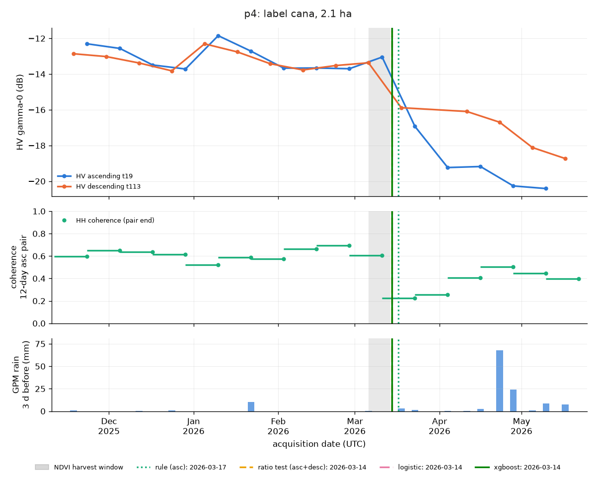
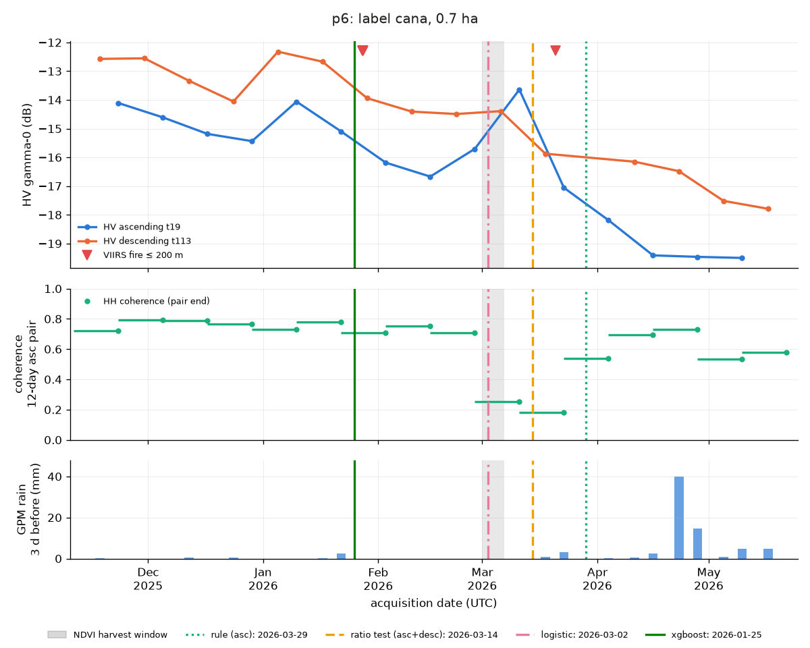
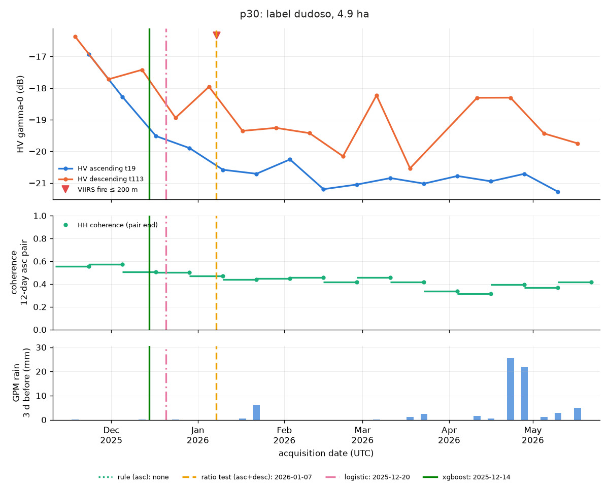

# Validation of the radar harvest detector

Independent checks of the NISAR harvest windows (`outputs/detect/detections.csv`).

<!-- optical-validation:start -->
## Optical validation with Sentinel-2 NDVI (exercise 6)

Generated by `scripts/06_optical_validation.py`.

| field | radar window | NDVI before (date) | NDVI after (date) | NDVI step date | verdict | offset vs radar (days) | notes |
|---|---|---|---|---|---|---|---|
| field_01 | detector 02-03→02-15 | 0.53 (01-30) | 0.15 (02-19) | 02-04 | **inconclusive** | +0 (inside) | bare after, but NDVI before 0.53 < 0.6 (drying cane?); optical cut between 01-10 and 02-04 |
| field_02 | detector 01-22→02-03 | 0.54 (01-15) | 0.15 (02-04) | 02-04 | **inconclusive** | +1 (after) | bare after, but NDVI before 0.54 < 0.6 (drying cane?); optical cut between 01-02 and 02-04; optical bracket overlaps radar window |
| field_03 | detector 01-22→02-03 | 0.57 (01-15) | 0.13 (02-04) | 01-25 | **inconclusive** | +0 (inside) | bare after, but NDVI before 0.57 < 0.6 (drying cane?); optical cut between 01-12 and 01-25 |
| field_04 | detector 02-15→02-27 | 0.13 (02-14) | 0.35 (03-01) | 01-25 | **refuted** | -21 (before) | already bare before window; optical cut between 01-15 and 01-25 |
| field_05 | detector 01-10→01-22 | 0.18 (01-10) | 0.19 (01-25) | 12-13 | **refuted** | -28 (before) | already bare before window; optical cut between 12-11 and 12-13 |
| field_06 | detector 01-22→02-03 | 0.23 (01-15) | 0.19 (02-04) | 01-15 | **refuted** | -7 (before) | already bare before window; optical cut between 01-12 and 01-15 |
| field_06 | reference 02-27→03-11 | 0.26 (02-24) | 0.21 (03-13) | 01-15 | **refuted** | -43 (before) | already bare before window; optical cut between 01-12 and 01-15 |

**Could not verify:**

* field_01 (detector): bare after, but NDVI before 0.53 < 0.6 (drying cane?)
* field_02 (detector): bare after, but NDVI before 0.54 < 0.6 (drying cane?)
* field_03 (detector): bare after, but NDVI before 0.57 < 0.6 (drying cane?)

### Method

* **Data:** Sentinel-2 L2A surface reflectance (`COPERNICUS/S2_SR_HARMONIZED`, Earth Engine),
  2025-11-01 .. 2026-05-31, tile 14QMF, scenes with tile cloud ≤ 30 %. Code:
  `src/zafra/optical.py`, driver `scripts/06_optical_validation.py`.
* **NDVI** = (B8 − B4) / (B8 + B4) per 10 m pixel. Pixels are masked per pixel with the
  Scene Classification Layer (kept: vegetation, bare soil, water, unclassified; dropped:
  cloud, cloud shadow, cirrus, dark/shadow, saturated, no data). Field value = unweighted
  mean over pixels whose centre lies in the polygon (same rule as the NISAR pixels).
* **Clear scene:** ≤ 10 % of the field's pixels masked. Same-day duplicates: keep the one
  with most clear pixels.
* **Before/after:** clearest clear scene within 20 days before the window's first radar date
  and within 20 days after its last (ties: closest to the window). Scenes inside the window
  are not used: the cut happened at an unknown time in there.
* **Verdict:** *confirmed* if NDVI_before ≥ 0.6, NDVI_after ≤ 0.35 and the drop ≥ 0.3;
  *refuted* if NDVI_after ≥ 0.6 (still standing) or NDVI_before ≤ 0.35 (already bare);
  otherwise *inconclusive*.
* **NDVI step date:** first clear scene with NDVI ≤ 0.35 after a clear scene ≥ 0.6.
  Offset = days from the radar window to the step (0 = inside; negative = optical step
  before the window starts; positive = after it ends).
* **Why this is independent evidence:** NDVI measures leaf chlorophyll/structure in reflected
  sunlight (665 and 842 nm); the radar measures L-band (24 cm) microwave volume scattering
  from the cane. Different physics, platform, orbit, time of day (S2 ~11:00 local, NISAR
  ~06:00 local) and processing, so their failure modes (clouds/smoke vs. soil moisture,
  lodging) are largely unrelated.

### Limitations

* **Cloud gaps.** The dry season is mostly clear, but a single cloudy or hazy week can leave
  no clear scene inside ±20 days. SCL misses some thin haze and smoke (common during the
  burning season), which lowers NDVI without being masked; a lone low value next to high
  ones should be treated with suspicion.
* **NDVI saturation.** Over a closed cane canopy NDVI flattens at ~0.8 and does not see the
  stalks, only the top leaves. It cannot tell a ripe field from a younger one, and drying
  or burned-but-standing cane already reads lower (0.4-0.6) before the cut. That makes the
  ≥ 0.6 "before" threshold strict for fields that were dried or burned before harvest.
* **Regrowth.** Ratoon cane re-sprouts within weeks; NDVI climbs back above 0.35 after
  ~1-3 months, so a late "after" scene can miss the bare phase.
* **Grids.** NISAR GCOV and Sentinel-2 are both 10 m UTM grids but not co-registered: their
  pixel edges do not line up, and SCL is 20 m (resampled by nearest neighbour). The same
  polygon samples slightly different ground in each sensor.
* **Mixed pixels at field edges.** A 10 m pixel on the boundary mixes the field with roads,
  furrows or a neighbouring field in a different state. In small fields (field_04 ~0.8 ha,
  ~80 pixels) edge pixels are a large share of the mean and can smear a partial harvest.
* **Partial harvests.** A field cut over several days, or in parts, gives an NDVI ramp over
  2-3 scenes, not a step; the step date is then the date the *average* crossed 0.35.
<!-- optical-validation:end -->

## Ground truth (2024/25)

Field **p36** (La Marometa, Tlaquiltenango, 21.4 ha). The grower reports it was **burned and
cut the same day, 2025-03-16** (source: grower, dated video, still to be confirmed). The
grower also says the mill (ingenio) cuts by region: La Marometa is finished that week, then
the neighbouring regions. NISAR starts on 2025-11-23, so the 2024/25 cut is checked with
Sentinel-1, Sentinel-2 and VIIRS. NISAR is used for the 2025/26 cut. Code:
`scripts/09_p36_ground_truth.py` (run log and figures in `outputs/front/`, not versioned).

### Does each source agree with 2025-03-16 (± 7 days)?

A window "agrees" if it overlaps 2025-03-09..03-23. Windows wider than 30 days are marked
weak: they cannot miss.

| source | window | agrees |
|---|---|---|
| VIIRS (FIRMS), pixel centre inside p36 | 2025-03-16 13:43 local (SNPP, conf. low, 11.0 MW) | **yes** |
| VIIRS (FIRMS), ≤ 500 m | same single detection (none other 03-05..03-25) | **yes** |
| S2 NDVI window (exercise-7 rule, ≥ 0.5 → ≤ 0.35) | 03-11 (0.38) → 03-16 (0.30) | **yes** |
| S2 NDVI before/after 03-16 (exercise-6 verdict) | 03-11 0.38 / 03-18 0.23 | inconclusive (before < 0.6) |
| S2 NDVI step (exercise 6, ≥ 0.6 → ≤ 0.35) | 2024-12-11 → 03-16 | yes, but 95 d wide (weak) |
| S1 VH ascending t78 (secondary), largest drop Nov-May | 03-11 → 03-23, −1.35 dB | **yes** |
| S1 VH descending t143, largest drop Nov-May | 02-07 → 04-02, −2.39 dB | yes, but 54 d wide (weak) |
| S1 VH asc / desc, exercise-4 rule (−3 dB) | none | n/a |
| S1 VH asc / desc, exercise-4 ratio test | none | n/a |

So VIIRS, NDVI and S1 ascending all put the cut on or right around 2025-03-16. It is also
the only VIIRS detection within 500 m of p36 between 2024-11-01 and 2025-04 (the next one is
on 05-06). The S2 scene on 03-16 itself (~11:00 local, before the 13:43 fire) already reads
0.30. It drops to 0.23 on 03-18, so the burn may have started that morning, or part of the
field was cut before.

Notes:

* **NDVI never reached 0.6 before the cut.** It slid from 0.75 (Oct) to 0.38 (03-11) over
  four months. The cane was drying in the field, as seen in exercise 6 (fields 01-03). The
  exercise-6 verdict is therefore "inconclusive", and the exercise-6 step window is 95 days
  wide. The exercise-7 rule (0.5 instead of 0.6) gives the 5-day window above.
* **Descending S1, as asked, cannot date this cut.** Over p36 relative orbit 143 has no scene
  between 2025-02-07 and 2025-04-02 (17 scenes in the season). The ascending track 78 has a
  regular 12-day revisit (27 scenes, 03-11 and 03-23). It is reported as a secondary series.
* **C-band VH barely sees the cut.** The drop is −1.35 dB (asc), against the 2-3 dB
  thresholds of the exercise-4 detectors. Neither the rule nor the ratio test fires, on
  either pass. The detectors were run unchanged on the S1 series (ENL 3.9 desc / 2.0 asc,
  estimated from the first three scenes), with thresholds set for L-band. C-band saturates
  on cane, and much of its signal comes from the top of the canopy, which the drying had
  already thinned. From late May the first rains swing VH by 2-3 dB, so the "largest drop"
  only counts drops whose later scene falls in Nov-May.

### Zafra 2025/26 on p36 (NISAR)

| signal | window |
|---|---|
| S2 NDVI (exercise-7 rule) | **2026-02-09 → 02-14** (written to `harvest_window_start/end` in `fields_v2.geojson`) |
| NISAR HH coherence, lowest 12-day pair | 02-03 / 02-15 (0.32; other pairs median 0.59) |
| NISAR HV asc, largest drop / ratio test | 02-15 → 02-27 (−1.4 dB / −2.2 dB vs baseline, medium) |
| NISAR HV desc, largest drop | 02-10 → 02-22 (−1.6 dB); ratio test fires late (04-23 → 05-05) |
| NISAR HV rule (−3 dB), asc and desc | none |
| VIIRS ≤ 500 m, 2025/26 | only 2026-04-20 14:10, 469 m from the edge (another field) |

The 2026 cut was in **February, not March**: about 30 days earlier than the 2025 date. NDVI
and coherence agree on 02-03..02-15. HV declines more gradually and only crosses the
detector thresholds one scene later. So La Marometa does not keep a fixed calendar slot from
one year to the next, at least for this field. With one field and two years, that is an
observation, not a rule.

### Harvest-front test (2024/25)

There are no surveyed polygons around p36. The candidate neighbours are **SNIC segments**
(Earth Engine, 150 m seed grid) of a monthly S2 NDVI stack, Oct 2024 - Jun 2025.

* 104 segments of 1-40 ha have their centroid within 700 m of p36.
* 70 pass the exercise-7 cane tests: a long NDVI plateau, ≤ 1 collapse per zafra, max ≥ 0.75.
* The 10 nearest were chosen, with centroids ≥ 150 m apart
  (`data/fields/p36_neighbours.geojson`, map `outputs/front/p36_front_2025.png`).

| id | dist m | ha | S2 window 2025 | days off ±7 test | S1 asc largest drop |
|---|---|---|---|---|---|
| n01 | 81 | 2.1 | 03-01 → 03-06 | 10 | 05-10 → 05-16 |
| n02 | 104 | 6.1 | 03-16 → 03-18 | 0 | 04-28 → 05-04 |
| n03 | 123 | 4.3 | 03-26 → 04-05 | 10 | 04-16 → 04-28 |
| n04 | 130 | 4.1 | 2024-11-16 → 11-21 | 115 | 2024-10-30 → 11-11 |
| n05 | 161 | 2.2 | 03-01 → 03-06 | 10 | 04-28 → 05-04 |
| n06 | 165 | 2.3 | no step found | — | 2024-11-11 → 12-05 |
| n07 | 167 | 1.1 | 2024-12-11 → 12-21 | 85 | 05-10 → 05-16 |
| n08 | 185 | 2.5 | 2024-12-31 → 2025-01-05 | 70 | 05-10 → 05-16 |
| n09 | 226 | 2.4 | 03-01 → 03-06 | 10 | 02-03 → 02-15 |
| n10 | 250 | 2.2 | 01-30 → 02-04 | 40 | 04-04 → 04-16 |

**Within ± 7 days of 2025-03-16: 1/10 by S2** (n02, which wraps p36's west side). S1 asc:
0/10. S1 desc: 0/10. With a looser ± 10 days, 5/10 by S2 (n01, n02, n03, n05, n09). These
are the segments next to p36 on its W, NW, E and SW sides, cut between 03-01 and 04-05. The segments
to the S/SE (n04, n07, n08) were cut in Nov-Jan, and n10 (N) in early February.

So the immediate neighbourhood was cut over about five weeks around p36. That fits a
regional campaign in March, but not a single week: the ±7-day form of the claim is not
supported. Three neighbours were cut 2-4 months earlier. The S1 drops of the neighbours do
not line up with their NDVI windows: on 2-6 ha segments the C-band VH changes at harvest
(mostly ≤ 1.5 dB) are within the scene-to-scene noise, so S1 does not add evidence here.

### Limitations

* **One grower report, one field.** The date comes from a dated video that has not yet been
  checked. VIIRS supports it independently: a low-confidence detection, but inside the
  polygon and on that day.
* **Segments are not fields.** SNIC follows NDVI phenology, not property boundaries. A
  segment can be half of one field or straddle two. Three neighbours share the exact window
  03-01 → 03-06, and n02 is directly adjacent to p36: some may belong to the same management
  unit. Overlap with p36 was capped at 10 % of each segment's area.
* **Window resolution.** S2 windows are 2-10 days (median 5). A window of 03-01 → 03-06 is
  "10 days off" even if that field was cut a day before the next one.
* **S1 orbit choice.** The requested descending pass leaves a 54-day hole around the
  ground-truth date. The ascending pass is used as supporting evidence only.

### Second grower date: 2026-02-26 (zafra 2025/26)

The grower gives a second date for p36: **burned and cut on 2026-02-26**. It is not yet clear
whether that was the start or the end of the cut on this 21 ha field. It is stored as
`ground_truth_date_2026` / `ground_truth_event_2026` in `fields_v2.geojson`. The
`harvest_window_start/end` (02-09 → 02-14, from NDVI) are left unchanged.

Three hypotheses were tested:

* (A) one event on 02-26;
* (B) a staged harvest from 02-09 to 02-26;
* (C) something else.

**VIIRS (FIRMS), 2026-02-01..03-05.** No detection inside the polygon or within 500 m.
There was none within 2 km either. That neither confirms nor rules out a burn: VIIRS only
looks at ~01:30 and ~13:30 local. The 2025 burn on p36 was caught, but many are not.

**Sentinel-2, every clear date 2026-01-25..03-15.** All 2143 pixels, ≤ 10 % masked. Bare =
NDVI ≤ 0.35. The four halves are cut through the centroid; N/S and W/E overlap.

| date | NDVI field mean | pixels bare: all / N / S / W / E | NBR (B8, B12) |
|---|---|---|---|
| 01-25 | 0.57 | 0.08 / 0.08 / 0.08 / 0.07 / 0.09 | 0.41 |
| 01-30 | 0.54 | 0.10 / 0.09 / 0.11 / 0.09 / 0.12 | 0.41 |
| 02-04 | 0.54 | 0.09 / 0.08 / 0.10 / 0.08 / 0.11 | 0.41 |
| 02-09 | 0.53 | 0.10 / 0.10 / 0.11 / 0.08 / 0.12 | 0.41 |
| 02-14 | 0.21 | **0.88** / 0.83 / 0.92 / 0.96 / 0.79 | −0.02 |
| 02-19 | 0.19 | 0.89 / 0.85 / 0.93 / 0.96 / 0.82 | −0.03 |
| 02-24 | 0.22 | 0.88 / 0.83 / 0.92 / 0.97 / 0.78 | −0.07 |
| 03-01 | 0.23 | 0.88 / 0.84 / 0.93 / 0.97 / 0.79 | −0.03 |
| 03-06 | 0.22 | 0.90 / 0.84 / 0.95 / 0.98 / 0.81 | −0.06 |
| 03-13 | 0.24 | 0.92 / 0.87 / 0.96 / 0.98 / 0.85 | −0.00 |

(03-11 is cloudy: 83 % masked.)

**NISAR.**

| HV asc (dB) | | HV desc (dB) | | HH coherence, asc pairs | |
|---|---|---|---|---|---|
| 02-03 | −14.69 | 02-10 | −14.72 | 01-22/02-03 | 0.62 |
| 02-15 | −15.94 | 02-22 | −16.29 | 02-03/02-15 | **0.32** |
| 02-27 | −17.29 | 03-06 | −15.86 | 02-15/02-27 | 0.42 |
| 03-11 | −17.33 | | | 02-27/03-11 | 0.46 |

For context, HH asc on the same dates: −9.54, −9.01, −10.77, −10.63 dB. The pairs after the
cut stay at 0.42-0.46 through April, against 0.59-0.66 before it.

**Interpretation.**

* **(A) A single burn-and-cut on 02-26: not supported for the cane.** Between the 02-09 and
  02-14 images (both ~11:00 local), 78 % of the field's pixels went from canopy to bare: 10 %
  → 88 %. It happened in all four halves at once, and NBR fell from 0.41 to −0.02. Two NISAR
  signals agree, independently of S2:
  * the coherence collapse is in the 02-03/02-15 pair;
  * the first HV drop is in 02-03 → 02-15 (asc) and 02-10 → 02-22 (desc).

  By 02-26 the canopy had been gone for at least 12 days.
* **(B) A harvest staged over 02-09..02-26: not supported either, at 10 m.** Every part of the
  field turned bare in the same 5-day interval. After 02-14 the bare fraction stays flat at
  0.88-0.90 in every half until 03-06, including 02-24 → 03-01. The pixels that never go
  bare (~10 %, mostly on the N and E halves) were already partly non-bare before the cut, and
  they do not change around 02-26. They are probably field edges, trees or borders, not a
  late strip of cane. A late strip smaller than ~1-2 % of the field (≤ 0.3 ha) would not show.
* **(C) Something did happen between 02-15 and 02-27, but it is not the cut.** NISAR asc
  drops a second time on the bare field (HV −1.35 dB, HH −1.76 dB, 02-15 → 02-27), and then
  stays flat. Possible causes:
  * burning or removing the cane trash (*soca* / residue) left after a green cut;
  * tillage or ratoon work;
  * the soil drying out.

  Optical does not show a burn: NBR on 02-24 → 03-01 goes up slightly (−0.07 → −0.03), and
  the scene-to-scene wobble is about ± 0.04. Descending HV does not repeat the second step
  (02-22 → 03-06: +0.4 dB). The 02-15/02-27 coherence (0.42) is no lower than the
  post-harvest pairs after it.

**Conclusion.** The data put p36's 2025/26 cut, and most likely its burn, at **2026-02-09 ..
02-14**. That is 12-17 days before the reported 02-26. Neither 02-26 as the cut date nor a
cut running until 02-26 fits. More likely, 02-26 refers to something else:
* a later residue burn or field operation (consistent with the second NISAR asc step);
* the grower's other parcel, or a wrong date on the video.

This is the question to put to the grower. If 02-26 were confirmed as the cut date, the S2
02-14 scene would have to be wrong for the whole field. Its in-field mask is 0.19 % and the
next three clear scenes agree with it, so that is unlikely.

**Limits.** VIIRS silence proves nothing. The halves are coarse. NBR on a bare field is noisy
(soil moisture, residue cover). The second NISAR step is seen on one pass only. All numbers
come from the caches written by `scripts/08_multisignal.py` (NISAR) and
`scripts/09_p36_ground_truth.py` (S2 series). The per-pixel bare fraction and NBR were
computed ad hoc in Earth Engine with the same SCL mask and pixel-centre rule; that code is not
in the repo.

## Exercise 4b: trained multi-signal detector vs the exercise-4 detectors

Generated by `scripts/10_harvest_classifier.py`. The full report, with per-row tables,
feature importances and coefficients, is `results/4b/comparison.md`. Method:
`docs/METHODS.md`, section "Multi-signal features and the trained classifier".

**Scope.** The detector dates the harvest on fields already known to be sugarcane. Deciding
whether a field is cane is a separate upstream step: the cane gate of exercise 4c. The false-alarm
column below is kept as the evidence for why that step is needed.

* **Reference:** the midpoint of each cane field's Sentinel-2 NDVI harvest window.
* **Error:** predicted date − reference, in days (negative = early).
* **Model dates** are out-of-fold (GroupKFold by field, 5 folds). The main model leaves out
  rain_3d_mm, gap_days, sharpness and slope_hv_3 (see the ablation for why).
* **Rule:** ascending HV, unchanged from exercise 4.
* **Ratio test (asc+desc):** the exercise-4 test is run on each orbit. Its per-scene
  decisions (≥ 2 dB below baseline and significant), merged in time, go through the same
  two-in-a-row rule as the models, so both sample every ~6 days. The ascending-only ratio
  test of exercise 4 is kept as a reference row.
* **Fields:** 26 with `label == cana` and a window (the exercise-4b brief expected 24), and
  12 non-cane controls: 11 `dudoso` and 1 `no_cana`, where the brief expected 14. p5 is
  `dudoso` but its NDVI hypothesis is cane, so false alarms are also given without it.

**With 26 fields, differences of 2-3 days between methods are within one acquisition and not
significant.**

### Per field

| field | optical window | rule (asc) date | ratio test (asc+desc) date | logistic date | xgboost date | rule (asc) err | ratio test (asc+desc) err | logistic err | xgboost err |
|---|---|---|---|---|---|---|---|---|---|
| p16 | 12-31 → 01-02 | 02-09 | 03-08 | 12-20 | 01-01 | +39 | +66 | -12 | +0 |
| p13 | 01-02 → 01-05 | 01-16 | 01-13 | 01-07 | 01-01 | +12 | +10 | +4 | -2 |
| p11 | 01-05 → 01-10 | 02-09 | 01-19 | 01-13 | 01-19 | +32 | +12 | +6 | +12 |
| p14 | 01-05 → 01-10 | 03-05 | 01-13 | 01-19 | 01-07 | +56 | +6 | +12 | +0 |
| p15 | 01-05 → 01-10 | 01-16 | 01-13 | 01-13 | 01-07 | +8 | +6 | +6 | +0 |
| p12 | 01-12 → 01-15 | 02-09 | 01-25 | 01-31 | 01-13 | +26 | +12 | +18 | +0 |
| p10 | 01-15 → 01-25 | 02-21 | 03-08 | 01-31 | 01-13 | +32 | +48 | +12 | -6 |
| p23 | 01-15 → 01-25 | — | 01-25 | 01-19 | 01-25 | missed | +6 | -0 | +6 |
| p24 | 01-15 → 01-25 | 02-09 | 02-12 | 01-19 | 01-19 | +20 | +24 | -0 | -0 |
| p25 | 01-15 → 01-25 | 03-17 | 02-12 | 01-31 | 01-31 | +56 | +24 | +12 | +12 |
| p2a | 01-15 → 01-25 | 02-21 | 05-07 | 02-12 | 01-19 | +32 | +108 | +24 | -0 |
| p9 | 01-15 → 01-25 | 02-21 | 02-18 | 01-31 | 01-31 | +32 | +30 | +12 | +12 |
| p1 | 01-30 → 02-04 | 01-28 | 01-31 | 01-31 | 01-31 | -4 | -1 | -1 | -1 |
| p2b | 01-30 → 02-04 | 02-09 | 02-06 | 01-31 | 01-31 | +8 | +5 | -1 | -1 |
| p36 | 02-09 → 02-14 | — | 03-08 | 02-06 | 02-12 | missed | +25 | -5 | +1 |
| p3 | 02-14 → 02-19 | 03-05 | 02-24 | 02-24 | 02-18 | +16 | +8 | +8 | +2 |
| p20 | 02-19 → 02-24 | 03-17 | 03-08 | 02-24 | 02-24 | +24 | +15 | +3 | +3 |
| p7 | 02-19 → 02-24 | 03-17 | 03-08 | 02-24 | 03-08 | +24 | +15 | +3 | +15 |
| p21 | 02-24 → 03-01 | 03-05 | 03-08 | 02-24 | 03-08 | +6 | +10 | -2 | +10 |
| p22 | 02-24 → 03-01 | 03-05 | 03-08 | 02-24 | 02-18 | +6 | +10 | -2 | -8 |
| p8 | 02-24 → 03-01 | 03-17 | 03-14 | 03-02 | 03-02 | +18 | +16 | +4 | +4 |
| p6 | 03-01 → 03-06 | 03-29 | 03-14 | 03-02 | 01-25 | +26 | +11 | -1 | -37 |
| p4 | 03-06 → 03-13 | 03-17 | 03-14 | 03-14 | 03-14 | +8 | +5 | +5 | +5 |
| p17 | 03-11 → 03-13 | 03-29 | 04-25 | 03-20 | 03-20 | +17 | +44 | +8 | +8 |
| p18 | 03-16 → 03-21 | 03-29 | 03-29 | 03-20 | 03-29 | +10 | +10 | +2 | +10 |
| p19 | 03-16 → 03-21 | 03-29 | 03-20 | 03-20 | 03-20 | +10 | +2 | +2 | +2 |

### Summary

| method | median abs. error (d) | mean error (d) | within ±6 d | within ±12 d | missed | false alarms, non-cane fields |
|---|---|---|---|---|---|---|
| rule (asc) | 19.2 | +21.5 | 1/26 | 8/26 | 2 | 2/12 (1/11 without p5) |
| ratio test (asc only, exercise 4) | 9.0 | +12.2 | 3/26 | 17/26 | 0 | 8/12 (7/11 without p5) |
| ratio test (asc+desc) | 11.5 | +20.2 | 7/26 | 15/26 | 0 | 8/12 (7/11 without p5) |
| logistic | 4.5 | +4.4 | 17/26 | 24/26 | 0 | 12/12 (11/11 without p5) |
| xgboost | 3.5 | +1.8 | 16/26 | 24/26 | 0 | 11/12 (10/11 without p5) |

False alarms on cane fields outside Nov-May cannot be measured: every NISAR acquisition on
disk is between 2025-11-18 and 2026-05-17.

### Ablation (same folds, same date rule)

| features | logistic: median abs. error / ±6 d / ±12 d | xgboost: median abs. error / ±6 d / ±12 d |
|---|---|---|
| main (no rain, gap_days, sharpness, slope) | 4.5 / 17 / 24 | 3.5 / 16 / 24 |
| main + sharpness and slope | 4.0 / 18 / 23 | 5.2 / 15 / 24 |
| main + rain and gap_days | 5.5 / 15 / 24 | 5.8 / 13 / 23 |
| main + all four (first run) | 5.0 / 16 / 23 | 6.8 / 12 / 24 |
| main without coherence | 9.0 / 10 / 19 | 7.2 / 12 / 22 |

Why the four features were dropped:
* **rain_3d_mm and gap_days are season markers here, not physics.** The only storms (GPM
  15-68 mm, Apr 23-28) and the only 24-day gap (descending, March-April) come after every
  harvest. In the first run, logistic gave rain a positive weight.
* **sharpness and slope_hv_3 add nothing measurable.** The hypothesis was that a step-vs-trend
  feature would separate drying from cutting. These 26 fields do not support it.

Reading the ablation:
* Removing coherence makes both models worse: 4.5 days (logistic) and 3.7 days (xgboost)
  in median, and 2-5 fewer fields within ±12 days. It is the only effect that goes the same
  way for both models.
* Putting the four dropped features back costs xgboost 1.7-3.3 days and moves logistic by
  −0.5 to +1.0 day. Both are within the noise of 26 fields, but nothing argues for keeping
  them.
* **The results are reproducible.** xgboost runs without row or column sampling
  (subsample = colsample_bytree = 1.0, fixed seed). Two consecutive runs give byte-identical
  dates and tables, and reversing the feature column order gives the same dates.
* The earlier run-to-run wobble came from column sampling (0.8). With the same features,
  xgboost gave 6.2 days in the first run and 4.0 after a reorder, with nothing else
  changed. The xgboost numbers above replace those runs.

Every variant still fires on 9-11 of the 11 strictly non-cane fields.

### Figures

Three representative fields. Every field's figure is in `results/4b/figures/`, regenerated
by the script and not versioned. Each figure has three panels: HV ascending and descending
with VIIRS fires (top), coherence of each 12-day ascending pair (middle), GPM rain (bottom).
The NDVI window is shaded and each method's date is a vertical line.

**Normal case: p4.** HV drops 2.5 dB on descending (03-06 → 03-18) and 3.9 dB on ascending
(03-11 → 03-23), and the coherence of the pair spanning the cut falls from 0.61 to 0.23. Every method is
within +5..+8 days.

**Drying cane: p6.** From late January HV declines slowly (−1.4 to −2.1 dB vs baseline)
while coherence stays at 0.71-0.78. xgboost reads that as harvested and fires 37 days
early. The real cut, in early March, has the coherence collapse (0.25, then 0.18).
Logistic dates it at −1 day.

**Non-cane false alarm: p30** (`dudoso`, hypothesis non-cane). HV falls 3.8 dB from November
to January (ascending) with no coherence collapse (0.44-0.58). The ratio test, logistic and xgboost all
fire; the rule does not.

### Honest read

* **On fields already known to be cane, the models date the cut better than the exercise-4
  detectors, at equal sampling.**
  * Median absolute error: 4.5 days (logistic) and 3.5 days (xgboost), against 11.5 for the
    ratio test on both orbits and 19.2 for the rule.
  * Within ±12 days: 24 of 26 fields for both models, against 15 and 8.
  * The rule is late on 23 of 26 fields. On most of them the first post-cut acquisition is
    1.5-3 dB below baseline, so the 3 dB threshold is only reached weeks later.
* **The both-orbit ratio test is worse than the ascending-only one** (11.5 vs 9.0 days;
  +108 on p2a, +66 on p16, +48 on p10, +44 on p17).
  * Descending HV often drops less than ascending after the cut: on p2a and p10 it stays
    near −1.5 dB while ascending is past −2.5 dB.
  * With interleaved scenes, a shallow orbit breaks the two-in-a-row run, so the test
    waits until both orbits pass the fixed 2 dB.
  * A per-orbit threshold, or "either orbit confirmed by its own next scene", would behave
    differently. That was not tried.
* **Where the models are worse than the both-orbit ratio test.**
  * Logistic on 2 of 26 fields: p12 (+18 vs +12) and p14 (+12 vs +6).
  * xgboost on 1 of 26: p6 (−37 vs +11), the drying case above.
  * Against the ascending-only ratio test, logistic is worse on 4 fields and xgboost on 6
    (p6, plus p7, p11, p21, p22 and p25 by 2-6 days).
* **False alarms.** The models fire on 10-11 of the 11 strictly non-cane fields, the ratio
  test on 7 and the rule on 1.
  * These fields lose 1.5-3 dB of HV from December to February with no coherence collapse.
    A learned threshold of roughly −1.5 dB vs baseline fires on that, and no training row
    shows such a decline labelled 0.
  * This is why the cane/no-cane step has to come first.
  * p5 (`dudoso`, hypothesis cane) has a real-looking cut ~03-11: coherence 0.22, −4.4 dB.
    It is probably a true detection.
* **Row-level scores are misleading.** Out-of-fold AUC is 0.98-0.99 because most rows are
  weeks away from the cut. The date errors and false alarms are the numbers that matter.

### Drying-cane cases

The rule's three latest fields, plus p2a (field_04 of exercises 4-6). The rows around the
true date are in `results/4b/comparison.md`.

| field | window | rule | ratio (asc+desc) | logistic | xgboost | what the signals show |
|---|---|---|---|---|---|---|
| p14 | 01-05 → 01-10 | +56 | +6 | +12 | +0 | asc −1.0 dB on 01-10 with coherence 0.18 (baseline 0.36), desc −3.0 dB on 01-17; asc HV does not meet the rule (−3 dB, then −2.5 dB) until March |
| p25 | 01-15 → 01-25 | +56 | +24 | +12 | +12 | coherence 0.21 on 01-22 (−0.16) while HV is at baseline; the HV drop (−2.4 dB) comes on 02-03 |
| p16 | 12-31 → 01-02 | +39 | +66 | −12 | +0 | a one-scene desc dip on 12-24 with a fire nearby (logistic fires early); coherence collapses on 01-10 (0.21, −0.38) |
| p2a | 01-15 → 01-25 | +32 | +108 | +24 | −0 | HV *rises* +1.7 to +2.8 dB on 01-22/01-29 while coherence falls to 0.29; desc first goes 2 dB below baseline on 05-17 |

In these four, coherence falls in the right pair while HV is still near baseline or even
rising (p2a, p25). That is the separation the models use. The "sharpness" of the HV step
becomes strongly negative only one acquisition later, together with the HV drop the
detectors already see.

### Limitations

* One season, 26 labelled fields, one region, provisional NISAR calibration (P05023).
* The reference windows come from NDVI (2-10 days wide), and drying lowers NDVI before the
  cut as well.
* The models are scored out-of-fold on dates, but the feature set (including dropping four
  features after the first run) and the date rule were chosen with these same fields in
  view. There is no untouched test set, so the numbers above are optimistic.

## Exercise 4c: cane / non-cane gate

Generated by `scripts/11_cane_gate.py`. The full report, with coefficients, the p36
neighbours and per-class feature medians, is `results/4c/comparison.md`. Method:
`docs/METHODS.md`, section "Field selection (cane gate, exercise 4c)".

**Read this first.** The labels come from NDVI phenology (script 07) and visual tracing. B,
C and the NDVI rule are partly scored against their own input, so their numbers are
optimistic. **A (radar only) is the honest test.**

**Operational gate: B (optical).** It drops no cane field; A drops 3, including p36, the only
grower-confirmed field. Optical selects the fields, radar dates the harvest. A is reported
with every prediction as `p_cane_radar`, the independent radar evidence. C is not
recommended: it gains nothing over B and drops p8. Reasoning: `docs/METHODS.md`, cane gate
section.

* **Fields:** 38 `fields_v2` polygons, zafra 2025-26, the only zafra with NISAR data.
  26 `cana` = positive; 11 `dudoso` + 1 `no_cana` = negative.
* **Evaluation:** leave-one-field-out, threshold P ≥ 0.5.

### Leave-one-field-out (2025-26)

| method | accuracy | precision (cane) | recall (cane) | TP | FP | FN | TN |
|---|---|---|---|---|---|---|---|
| A: radar only (`p_cane_radar`) | 0.89 | 0.96 | 0.88 | 23 | 1 | 3 | 11 |
| A+F: radar + VIIRS fire | 0.92 | 0.96 | 0.92 | 24 | 1 | 2 | 11 |
| **B: optical only (default gate)** | 0.97 | 0.96 | 1.00 | 26 | 1 | 0 | 11 |
| C: radar + optical + fire (not recommended) | 0.95 | 0.96 | 0.96 | 25 | 1 | 1 | 11 |
| rule: NDVI (script 07) | 1.00 | 1.00 | 1.00 | 26 | 0 | 0 | 12 |
| rule: radar (drop + coherence) | 0.58 | 0.86 | 0.46 | 12 | 2 | 14 | 10 |

With 38 fields, one field is 2.6 points of accuracy. A, A+F, B and C are within 3 fields
of each other.

### Misclassified fields

P(cane), leave-one-out; bold = wrong.

| field | label | A | A+F | B | C | why |
|---|---|---|---|---|---|---|
| p5 | dudoso (hyp. cane) | 1.00 | 1.00 | 0.71 | 0.98 | Probably cane. Every model calls it cane; 4b found a real-looking cut ~03-11 (coherence 0.21, −4.8 dB HV drop on the same date). |
| p2a | cana | **0.28** | 0.66 | 0.98 | 0.79 | HV *rises* after the cut (4b). Its largest drop (−8 dB) is a descending scene on 05-17, long after the cut, so joint_collapse = 0. |
| p16 | cana | **0.496** | 0.62 | 0.97 | 0.93 | Largest HV drop on 05-05 (late-season), coherence minimum on 01-10: no joint collapse. |
| p36 | cana | **0.20** | **0.33** | 0.70 | 0.52 | The only grower-confirmed field. Weak radar cut: largest HV step −1.6 dB, coherence minimum 0.32 (cane median 0.21), ENL 2.1 (lowest of the cane fields). |
| p8 | cana | 0.90 | **0.05** | 0.74 | **0.28** | 8 VIIRS detections ≤ 200 m, the most of any field; the fire coefficient is negative, so fire pushes it out. Largest HV step only −2.0 dB. |

The radar rule misses 14 of 26 cane fields. On 8 of the 26 the largest single HV drop falls
after Apr 20, after the late-April storms and not at the cut, so `joint_collapse` is 0 on 11
of 26 cane fields.

### Gate + 4b harvest detector: false alarms on the 12 non-cane fields

A false alarm is a sustained detection in Nov-May on a non-cane field (`results/4b/dates.csv`).
After gating, a field counts only if the gate's leave-one-out decision is cane.

"Radar says no" lists fields the gate passes although `p_cane_radar` < 0.5. Those are the
fields a map should flag.

| gate | rule (asc) | ratio test (asc only) | ratio test (asc+desc) | logistic | xgboost | passed, radar says no | cane fields gated out |
|---|---|---|---|---|---|---|---|
| no gate | 2/12 | 8/12 | 8/12 | 12/12 | 11/12 | — | 0/26 |
| A: radar only (`p_cane_radar`) | 1/12 | 1/12 | 1/12 | 1/12 | 1/12 | — | 3/26 (p2a, p16, p36) |
| A+F: radar + VIIRS fire | 1/12 | 1/12 | 1/12 | 1/12 | 1/12 | p2a, p16 | 2/26 (p8, p36) |
| **B: optical only (default gate)** | 1/12 | 1/12 | 1/12 | 1/12 | 1/12 | p2a, p16, p36 | **0/26** |
| C: radar + optical + fire (not recommended) | 1/12 | 1/12 | 1/12 | 1/12 | 1/12 | p2a, p16, p36 | 1/26 (p8) |
| rule: NDVI (script 07) | 0/12 | 0/12 | 0/12 | 0/12 | 0/12 | p2a, p16, p36 | 0/26 |
| rule: radar (drop + coherence) | 1/12 | 2/12 | 2/12 | 2/12 | 2/12 | p31 | 14/26 |

The one remaining false alarm under every model gate is p5, which is probably cane.

### Optical in 2024-25 (no radar)

Same features and labels, leave-one-field-out on 2024-25:
* B reaches 0.92 (24/26 cane, 1 false positive).
* The NDVI rule computed on that crop year alone reaches 0.84 (20/26 cane, 0 false
  positives). The labels were set on the full 21-month series, so a single crop year
  misses some of the plateau.

### p36 neighbours (unlabelled)

Ten SNIC segments within 250 m of p36 (`data/fields/p36_neighbours.geojson`). All ten were
`cana` by NDVI in 2024/25. In 2025-26:
* The default gate (B) calls n02 (0.50) and n04 (0.67) cane, n09 just below (0.49), and the
  rest ≤ 0.20.
* The radar evidence (A) is 0.50 for n03, 0.68 for n04 and ≤ 0.21 for the others.
* **n03, n04:** NDVI goes 0.45 → 0.2 on 04-30. NISAR shows a −4 to −4.5 dB HV step on 05-10
  with coherence down to 0.26-0.31. That looks like a late cut. Variant A is uncertain
  (0.50-0.68). The optical features miss n03 (B gives 0.12): the cane was already below 0.5
  before the cut, so the NDVI drop is < 0.3 and no collapse is counted. Here radar sees a
  cut that the default gate does not.
* **n02, n09:** a clear NDVI step on 02-14 (0.6 → 0.35). The radar step is small
  (−0.9 / −1.1 dB) and A gives 0.15 / 0.21. These are probable radar misses, like p36
  itself.
* **n01, n05-n08, n10:** NDVI declines smoothly from 0.8 (October) to 0.3 (February) with no
  step. Coherence stays at 0.53-0.79 and no HV step exceeds 1.3 dB. These look like fields
  that were not harvested this zafra, or were not cane in 2025-26. Every variant gives a
  low P.

### Honest read

* **Radar alone separates cane from these non-cane fields fairly well:** 34/38
  leave-one-out, 23 of 26 cane fields, with 1 false positive (p5, probably cane).
  * The strongest radar evidence is a high pre-season HV level (cane −14 dB median vs
    −18 to −19 dB) and a low coherence minimum (0.21 vs 0.32 for `dudoso`).
  * The timing of the cut (joint_collapse) helps much less than expected, because the
    late-April storms produce the largest HV drop on many fields.
* **Optical adds 3 cane fields** (p2a, p16, p36), but it is scored against its own rule.
  C (radar + optical) is not better than B alone.
* **As a gate, every model variant removes 10-11 of the 11-12 false alarms** of every 4b
  detector, at a cost of 0-3 cane fields.
* **The radar-only gate drops p36**, the one field with a grower-confirmed harvest. Its
  radar cut is weak in every signal. That is why the operational gate is B (optical), with
  A shown next to it as `p_cane_radar`.

### Limitations

* 38 fields, one zafra (radar), one area. The labels are optical, so B's score is partly
  circular and even A's is agreement with NDVI, not with field visits.
* **La Marometa fields (p36, n02, n09) show clear NDVI cuts with a weak radar response.**
  * Largest HV step: −1.6, −0.9 and −1.1 dB. Cane median: −3.5 dB.
  * Coherence minimum: 0.32, 0.44 and 0.45. Cane median: 0.21.
  * The cause is unknown. Candidates are field size, slope and row orientation relative to
    the look direction. To be investigated.
* The optical collapse test (drop > 0.3 within 30 days) misses cuts of cane that was
  already dry, such as n03.
* The non-cane fields are mostly pasture/scrub `dudoso` polygons next to cane. Other land
  covers are untested.

## Exercise 4d: field segmentation and the first area-wide harvest map

Generated by `scripts/13_field_segmentation.py` (segmentation, `results/4d/segmentation.md`)
and `scripts/14_area_harvest_map.py` (gate + detector, `results/4d/area_summary.json`).
Method: `docs/METHODS.md`, "Field delineation".

### Segmentation against the 38 hand-traced polygons

| variant | segments | median IoU | mean IoU | IoU ≥ 0.5 | over | under | missed |
|---|---|---|---|---|---|---|---|
| SAM ViT-B, 2026-01-10 true colour | 5509 | 0.10 | 0.23 | 9/38 (24 %) | 0 | 25 | 8 |
| SAM ViT-B, NDVI stack (median, std, min) | 2762 | 0.02 | 0.11 | 2/38 (5 %) | 0 | 18 | 18 |
| **Felzenszwalb, NDVI stack (chosen)** | 39542 | **0.58** | **0.58** | **24/38 (63 %)** | 4 | 10 | 0 |

Per-field table: `results/4d/segmentation.md`.
* **SAM produces merged blocks.** Contiguous cane fields of one colour come out as one mask.
  On the 26 cane fields its true-colour IoU is mostly 0.0-0.2.
* **Where a field contrasts with its surroundings SAM does well:** the `dudoso` pasture
  fields p29-p34 (0.54-0.83) and the large p36 (0.65, against 0.27 for Felzenszwalb).
* **Felzenszwalb errors are mostly under-segmentation of the small fields** (p2a, p6, p26,
  p28: 0.3-0.8 ha, below or near the 0.5 ha floor) and splitting of p36 (21 ha), which is
  cut in pieces.
* The Felzenszwalb setting was picked from three on these same fields, so its score is
  somewhat optimistic.

### Area-wide counts (zafra 2025-26)

| quantity | value |
|---|---|
| segments after cleaning | 39 542 (75 684 ha) |
| with optical / radar features | 39 542 / 39 542 |
| predicted cane (gate B, P ≥ 0.5) | **6 014 segments, 9 943 ha** |
| gate confidence, all segments | 29 680 high, 9 862 uncertain |
| gate confidence, cane segments | 3 983 high, 2 031 uncertain |
| cane segments where radar-only gate agrees (p_cane_radar ≥ 0.5) | 3 855 (64 %) |
| non-cane segments with p_cane_radar ≥ 0.5 | 1 153 |
| cane segments with a harvest date (xgboost) | 4 629 (8 080 ha); logistic: 4 610 |
| date confidence (high / medium / low) | 3 049 / 1 115 / 465 |
| harvest date quantiles 10/25/50/75/90 % | Dec 14 / Jan 7 / Feb 6 / Mar 8 / Apr 13 |
| xgboost vs logistic date | median difference 6 d, 81 % within 12 d |

The dating rows of this table are from exercise 4d, before the baseline requirement. The
corrected figures are in the next section (3 976 dated segments, 6 867 ha).

Gate "cane" by WorldCover class: cropland 2 989 segments (5 611 ha), tree cover 2 036
(2 720 ha), grassland 791 (1 313 ha), shrubland 196 (282 ha).

**Comparison with official cane area.** `docs/DATA_SOURCES.md` has no cane-area figure for
the Ingenio Emiliano Zapata (Zacatepec) supply area or for Morelos.
TODO (author): fill the mill's harvested cane area for zafra 2025/26 from CONADESUCA and
compare with the 9 943 ha above. The AOI is the FIRMS bbox, not the mill's supply area, so
even a matching figure would need the supply-area boundary to be meaningful.

### Sanity read: harvest dates against fires (corrected in exercise 4e)

Exercise 4e replaced the first version of this read. The figures below come from
`scripts/14_area_harvest_map.py` with the baseline requirement (METHODS, "Field
delineation"), fires restricted to cane, and WorldCover flags. They are in
`results/4e/area_summary.json`, `results/4e/weekly.csv` and
`results/4e/harvest_vs_fires_weekly.png`. The 4d version is kept in `results/4d/`.

**1. The baseline requirement removes the December artefact.** A date is now emitted only
after at least 3 standing acquisitions in the candidate's own orbit.

| | 4d (no baseline rule) | 4e (3-look baseline) |
|---|---|---|
| cane segments with a date | 4 629 (8 080 ha) | **3 976 (6 867 ha)** |
| dated in the week of Dec 8 (the 4d peak) | 489 | **0** |
| dated in the weeks of Nov 24 + Dec 1 | 53 | 0 |
| dated Dec 1-20 | 748 | 190 (all Dec 20, the earliest datable day) |
| status `no_baseline` | — | 653 segments (1 213 ha) |
| status `harvested_before_coverage` | — | 0 |
| date quantiles 10/25/50/75/90 % | Dec 14 / Jan 7 / Feb 6 / Mar 8 / Apr 13 | Jan 1 / Jan 19 / Feb 12 / Mar 14 / Apr 19 |
| date confidence high / medium / low | 3 049 / 1 115 / 465 | 2 732 / 898 / 346 |

* **The whole mid-December peak goes.** It was candidates at the 2nd-3rd look of an orbit,
  whose "drop" was measured against a baseline that included the candidate itself.
* **No segment gets `harvested_before_coverage`.** The detector is field-relative: a field
  cut before November is low from its first look, its own baseline is low too, and it
  reads as standing. Such fields end as `not_detected`. The radar detector cannot see
  pre-season cuts.
* **Price on the 26 training fields:** 25 keep their exact date. p16 (NDVI window Dec 31 -
  Jan 2) becomes `no_baseline`: its descending track flickers and has only 2 standing looks
  before its Jan 5 candidate.
* **Looser variant (either orbit counts).** It keeps 496 dates in Dec 1-20 and loses no
  training field. It was rejected because 3 standing descending looks say nothing about
  the ascending baseline the candidate is measured against.

**2. Fires restricted to cane.** "Near cane" = VIIRS detections within 200 m of a gated
cane segment: 673 of the 1 097 detections in the AOI (61 %).

| weekly r, harvests vs fires | same week | fires +1 week | best lag |
|---|---|---|---|
| 4d dates, all AOI fires | 0.59 | 0.64 | +1 week (0.64) |
| 4e dates, all AOI fires | 0.70 | 0.58 | same week (0.70) |
| 4e dates, fires near cane | **0.71** | 0.56 | fires 2 weeks *before* (0.73) |

**April** (Apr 1-30):

| | value |
|---|---|
| fires in the AOI | 189 |
| fires near cane | 103 |
| harvest detections | 479 segments, 754 ha (479 under the 4d rule too) |

* Fires per detection in April: 103 / 479 = 0.22, against 673 / 3 976 = 0.17 over the
  season. Once restricted to cane, April is not out of line.
* **About half of April's fires are not near cane.** The AOI peak of 73 in the week of
  Apr 6 has only 37 near cane. The 4d impression of "fires peak, harvests fall" came mostly
  from non-cane burning.
* **The week of Mar 30 has no detections**, from cadence rather than ground truth: no
  descending scene near Mar 30 (a 24-day gap), so no midpoint date falls in that week.

**3. WorldCover flag.** 2 827 cane segments (4 034 ha) are mapped by WorldCover 2021 as tree
cover or grassland (`wc_disagrees`). They are kept and outlined on the map. The 1 378 of
them with no harvest date get `confidence = "uncertain"` and are cross-hatched.
* On the map they are mostly thin strips along ravines and isolated patches in the hills,
  which looks like riparian vegetation.
* Their outcome differs from the other cane segments:

  | | flagged by WorldCover | other cane segments |
  |---|---|---|
  | no harvest detected | 42 % | ~6 % |
  | harvest dated | 51 % | 79 % |

* So a large part of the flagged segments are probably gate false positives. The flag
  does not prove it: cane is also mapped as trees by WorldCover.

**4. Merging fragments does not recover fields** (`scripts/15_merge_fragments.py`,
`results/4e/merge.md`). Adjacent cane segments were merged when their dates differ by ≤ 6
days (a group spans ≤ 6 days), or both are undated with the same status.

| layer | cane polygons | median cane ha | IoU ≥ 0.5 (38) | median IoU (38) | IoU ≥ 0.5 (26 cane) | median IoU (26 cane) | under-segmented (38) |
|---|---|---|---|---|---|---|---|
| unmerged (**delivered**) | 6 014 | 1.22 | 24 | 0.58 | 14 | 0.53 | 10 |
| merged, ≤ 6 days | 3 624 | 1.46 | 12 | 0.27 | 3 | 0.16 | 27 |
| merged, identical dates only | 4 144 | — | 14 | 0.38 | — | — | 24 |

* Neighbouring fields are cut within days of each other, and at a 6-12 day revisit they
  share a date, so merging on dates glues separate fields together.
* The unmerged layer stays the delivered one.
* The frontend file `data/results/harvest_map_2025_26_slim.geojson` holds the 6 014 gated
  cane polygons (all statuses, 5 m simplified, 10 columns) in 8.2 MB.
* With the ~33 500 non-cane segments the file would be 36-61 MB even at 10 m tolerance.
  The map shows non-cane as basemap.

**Overall read.** After 4e, the weekly harvest counts and the weekly fires near cane rise
and fall together (r ≈ 0.7), from late December to May. The remaining mismatches are
cadence gaps (week of Mar 30), and the cut-off before ~Dec 20, which removes any real early
harvest along with the artefact.

### Limitations

* **VIIRS catches only ~9 % of harvests at field level.** 8.7 % of the 3 976 dated
  segments have a VIIRS detection within 200 m in the 7 days before the first harvested
  acquisition (8 % in 4d).
  * The causes are short burns (30-60 min) in small fields, missed between the ~6 daily
    overpasses bunched at ~01:30 and ~13:30, and 375 m pixels that miss small fires or
    place them in a neighbouring field.
  * **Fire is a zone-level check (weekly counts over many fields), not a field-level one.**
    A field without a VIIRS detection is not evidence of an unburned or unharvested field.
* **No harvest can be dated before ~Dec 20.** NISAR provisional coverage over the AOI
  starts in November 2025 (descending Nov 18, ascending Nov 23). The baseline needs 3
  standing looks in the candidate's orbit, so the first datable cut is the 4th look of an
  orbit (desc Dec 24, asc Dec 29), giving dates from Dec 20 on. Any real harvest before
  then is lost, together with the artefact. With a full year of data the baseline comes
  from October, before the zafra starts, and this limit disappears.
* The segments are fragments of fields (median cane segment 1.2 ha vs 2.6 ha hand-traced).
  The counts above are segment counts, not field counts.
* The gate and the detector were trained on 38 and 26 hand-traced fields respectively and
  are applied here to 39 542 polygons of every land cover. Nothing in this section is an
  accuracy figure: it is a plausibility check against fires.

## Exercise 5: transfer to a second site (Ribeirão Preto, Brazil)

Details: `results/5_brazil/transfer.md` and `validation.md` (script 16). No NISAR L2
product covers any Thai cane region in the 2025-26 window, so the fallback site is a
30 × 31 km window near Ribeirão Preto, São Paulo, for the safra 2026-27 (harvest Apr 1 –
Nov 30). The radar covers 2026-06-22 .. 10-22. **The Morelos gates, detector and
segmentation parameters are applied unchanged.** The season, AOI, CRS, paths and the
choice of delivered gate (`gate_variant`) come from `configs/brazil.yaml`.

**Caveats that shape every number below:**
* mechanized green harvest with a trash blanket, so there is almost no burning;
* an opposite season;
* no radar before late June, so the baseline is Jun–Jul rather than Jan–Mar, when the
  cane would still be standing;
* no reference fields: the checks are against an independent NDVI rule and MapBiomas 2024,
  not ground truth.

### The gate (land cover), judged against MapBiomas 2024

| gate | ha gated | precision (ha) | recall (ha) |
|---|---|---|---|
| A radar (**delivered** on Brazil) | 57 044 (65.3 % of AOI) | 72.0 % | 63.7 % |
| B optical (pure transfer; delivered on Morelos) | 42 491 (48.6 %) | 77.8 % | 51.2 % |
| B with local labels (MapBiomas, 5-fold CV by 3 km blocks; reference only) | 62 075 (71.0 %) | 89.0 % | 85.6 % |

MapBiomas maps 64 556 ha (73.9 %) as cane.
* **The optical gate transfers poorly: it finds about half of the cane area.**
* The radar gate agrees better, so it is the delivered gate here. This is the reverse of
  Morelos.
* Re-fitting B on local labels closes most of the gap. That shows the features are usable
  and the Morelos fit is what fails to transfer. Its score is against the same map it
  learned from, so it is optimistic.
* Gate A still calls 6 346 ha of MapBiomas forest (riparian corridors) cane. Its
  confidence tier does not separate MapBiomas cane (61 % "high" vs 62 % "uncertain").

### The detector (dates), judged against independent NDVI windows

The sample is 40 dated and 20 undated gated-cane segments (seed 5), drawn from the
delivered gate's cane set; the NDVI windows come from the script-07 rule on the local S2
stack.

| delivered gate | median abs. error | mean error | within ±6 d | within ±12 d | missed | false alarms |
|---|---|---|---|---|---|---|
| A (delivered) | 5.0 d | +6.7 d | 21/40 | 30/40 | 10/20 | 4/40 |
| B (first run) | 4.5 d | +8.1 d | 25/40 | 28/40 | 7/20 | 2/40 |

* **Given a cane segment with a standing baseline, the Morelos detector dates Brazilian cuts
  within about a week of an NDVI rule.** The median error is 4.5-5 d (Morelos 4b: about
  3.5 d against labels), with a late tail.
* A's wider cane set adds marginal segments, which shows up as more misses and false
  alarms. The detector is the same model in both rows.
* **Coverage limits it more than accuracy does.** Of the 21 171 gate-A cane segments:
  * 4 780 are dated (p10 / median / p90 = 07-30 / 08-28 / 10-09);
  * 6 576 have no standing baseline;
  * 9 815 have no detection.
* **Date uncertainty.** Each harvest GeoJSON (all sites) now carries
  `date_uncertainty_days`, half the gap between the last standing and the first harvested
  acquisition. On Brazil:
  * 1 466 segments are dated 07-30 ± 12 d, from the single 24-day gap 07-18 → 08-11
    (no ascending look on 07-30). This is the whole July "peak".
  * 69 % of dated segments are within ±6 d.

  **The frontend should display this uncertainty with every date** (e.g. "30 Jul ± 12 d"
  and a hatched or lighter colour for wide windows), instead of a bare date.
* **HV drop at harvest:** median over dated segments −5.1 dB (gate A; −5.4 dB with B),
  against −3.0 dB on the Morelos area map and −3.5 dB on the Morelos labelled fields. This
  is larger, not smaller as a green harvest suggested. **Open hypothesis, not established:**
  * larger fields, with less edge mixing within a segment;
  * very dry soil in the São Paulo winter (Aug–Sep), which lowers the backscatter of the
    cut field;
  * selection by the detector is a third possibility.

  None has been tested.

### Limitations

* **The fire check is not meaningful here.** There are 17 VIIRS fires in the season, all
  before the first datable date, and r ≈ −0.1.
* MapBiomas is a 2024 map, majority-voted per segment. Disagreement is partly MapBiomas
  error and partly segments that mix cane and riparian strips.
* The NDVI check is the same rule that defined the 4b training labels, so it is agreement
  with an optical method, not with grower dates.
