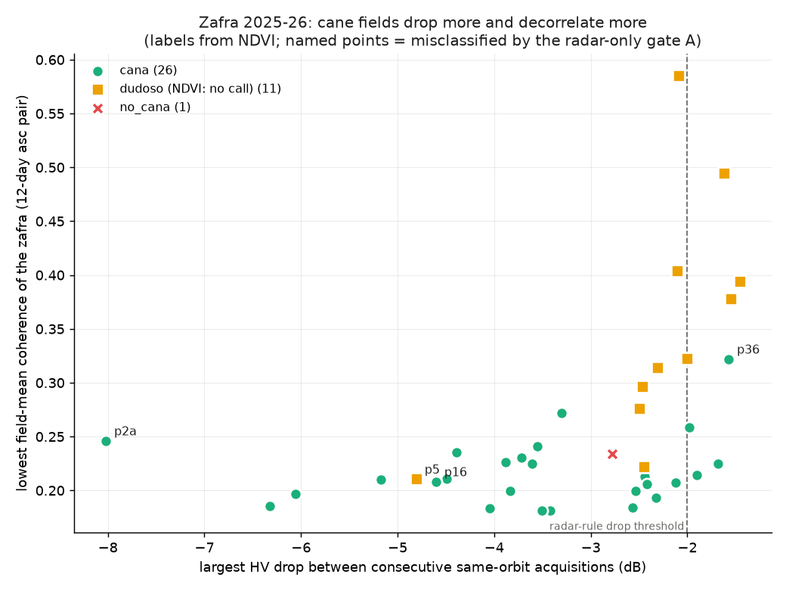
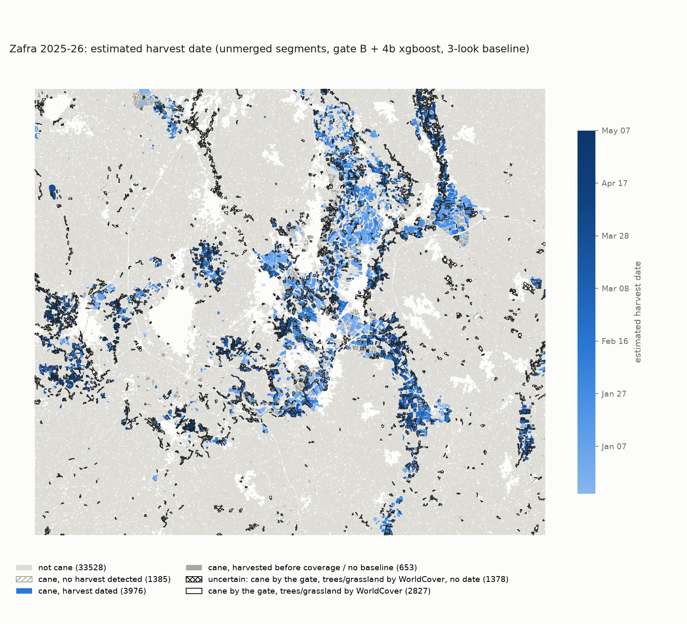
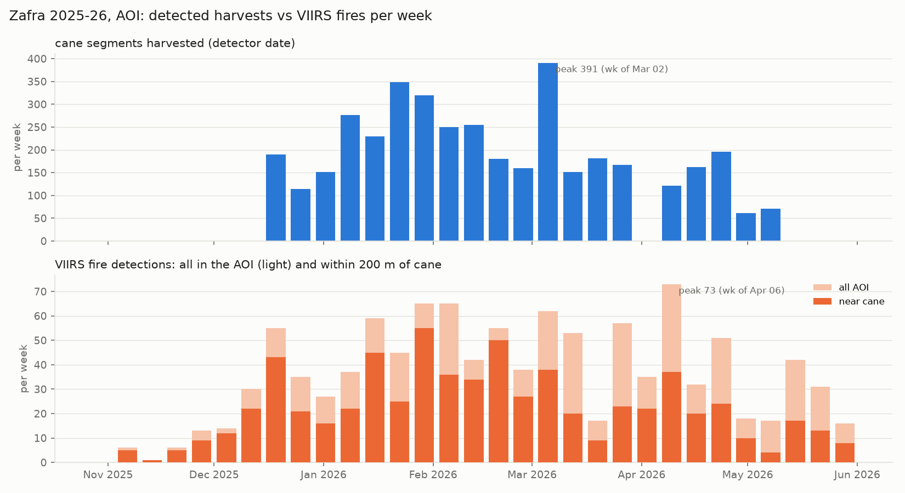
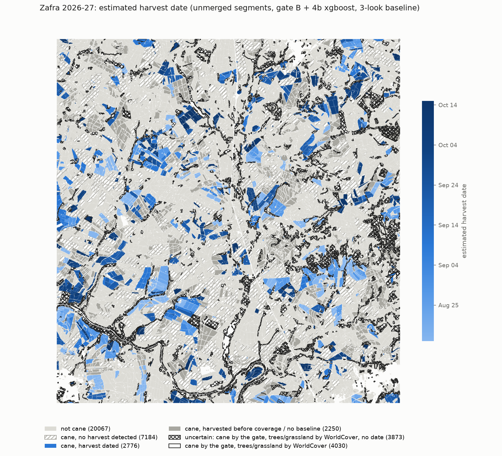

# Validation

What each part of the pipeline was checked against, with the numbers from the committed
results. One table per exercise; the full generated reports are linked from each section.
Method details: [METHODS.md](METHODS.md). Exercise and script numbering: [METHODS.md,
exercise and script map](METHODS.md#exercise-and-script-map).

**What "reference" means here.** There are no surveyed harvest dates. The 26 cane fields'
reference dates are Sentinel-2 NDVI harvest windows (script 07, 2-10 days wide, median 5),
and only p36 has a grower report. In Brazil the checks are against an NDVI rule and the
MapBiomas land-cover map. Every number below is agreement with one of these references,
not accuracy against field visits.

## Summary

| check | result | source |
|---|---|---|
| Harvest date, xgboost, 26 cane fields, out of fold | median abs. error 3.5 d; 24/26 within ±12 d | `results/4b/comparison.md` |
| Cane gate B (delivered on Morelos), leave-one-field-out | 37/38 (partly circular) | `results/4c/comparison.md` |
| Cane gate A (radar only), leave-one-field-out | 34/38 | `results/4c/comparison.md` |
| Non-cane false alarms of the detector, without / with gate B | 11/12 / 1/12 | `results/4c/comparison.md` |
| Segmentation, Felzenszwalb vs 38 hand-traced fields | 24/38 with IoU ≥ 0.5, median IoU 0.58 | `results/4d/segmentation.md` |
| Morelos area dated (zafra 2025-26) | 3 976 of 6 014 cane segments; 6 867 of 9 943 ha | `results/4e/area_summary.json` |
| Weekly harvests vs VIIRS fires within 200 m of cane | r = 0.71 (same week) | `results/4e/area_summary.json` |
| Brazil gate B (delivered) vs MapBiomas 2024 | precision 77.8 %, recall 51.2 % (by area; radar gate A: 74.9 % / 46.9 %) | `results/5_brazil/validation.md` |
| Brazil dates vs NDVI rule (40 dated segments) | median abs. error 2.5 d; 37/40 within ±12 d | `results/5_brazil/validation.md` |
| Summaries, LLM path, verifier pass | 57/58 polygons (98.3 %) | `results/6/alert_counts.json` |

## Ground truth: p36

p36 (La Marometa, Tlaquiltenango, 21.4 ha) is the only field with a grower report. Code:
`scripts/09_p36_ground_truth.py` (run log and figures in `outputs/front/`, not versioned).

| signal | 2024-25 (grower: burned and cut 2025-03-16) | 2025-26 (grower: burned and cut 2026-02-26) |
|---|---|---|
| VIIRS (FIRMS) | 2025-03-16 13:43 local, inside the polygon (SNPP, low confidence, 11.0 MW); the only detection within 500 m from 2024-11-01 to April | none within 2 km from 02-01 to 03-05 |
| Sentinel-2 NDVI window (script-07 rule) | 03-11 (0.38) → 03-16 (0.30) | **02-09 → 02-14**: bare pixels 10 % → 88 %, in all four halves of the field |
| NISAR HH coherence, lowest 12-day pair | no NISAR | 02-03 / 02-15: 0.32 (other pairs median 0.59) |
| HV drop | S1 VH ascending: 03-11 → 03-23, −1.35 dB (C-band; the exercise-4 detectors do not fire) | NISAR first drop asc 02-03 → 02-15 (−1.25 dB), desc 02-10 → 02-22 (−1.6 dB) |
| 4b xgboost date | – | 02-12 (+1 d vs the NDVI window) |
| agrees with the grower date? | **yes**, within ± 7 days, by VIIRS, NDVI and S1 ascending | **no**: the data put the cut at 02-09..02-14, 12-17 days before 02-26 |

* **2026-02-26 does not fit a cut** on this field: by then the canopy had been gone for at
  least 12 days, and nothing changed at 10 m around 02-26. A second NISAR ascending drop
  (HV −1.35 dB, 02-15 → 02-27) on the already bare field may be a residue burn or field
  work. The question goes back to the grower.
* **Harvest front.** Of 10 neighbouring segments (SNIC, ≤ 250 m), 1 was cut within ± 7 days
  of 2025-03-16 by NDVI and 5 within ± 10 days; three were cut 2-4 months earlier. The
  neighbourhood was cut over about five weeks, not in one week.
* p36's radar response is weak in every signal (section 4c). The bare-fraction and NBR
  numbers were computed ad hoc in Earth Engine; that code is not in the repository.

## Exercise 4b: harvest detector

Generated by `scripts/10_harvest_classifier.py`; per-field table, ablation and coefficients in
[`results/4b/comparison.md`](../results/4b/comparison.md). Error = predicted date − NDVI
window midpoint. Model dates are out of fold (GroupKFold by field, 5 folds). The ratio test
on both orbits goes through the same date rule as the models (~6-day sampling for both).

| method | median abs. error (d) | mean error (d) | within ±6 d | within ±12 d | missed | false alarms, 12 non-cane fields (11 without p5) |
|---|---|---|---|---|---|---|
| rule, ascending (exercise 4) | 19.2 | +21.5 | 1/26 | 8/26 | 2 | 2/12 (1/11) |
| ratio test, ascending only (exercise 4) | 9.0 | +12.2 | 3/26 | 17/26 | 0 | 8/12 (7/11) |
| ratio test, both orbits | 11.5 | +20.2 | 7/26 | 15/26 | 0 | 8/12 (7/11) |
| logistic | 4.5 | +4.4 | 17/26 | 24/26 | 0 | 12/12 (11/11) |
| **xgboost (delivered)** | **3.5** | **+1.8** | 16/26 | 24/26 | 0 | 11/12 (10/11) |

* With 26 fields, differences of 2-3 days are within one acquisition and not significant.
* The rule is more than 6 days late on 23 of 26 fields: the first post-cut look is usually
  1.5-3 dB below baseline, so the 3 dB threshold is reached weeks later.
* Where the models are worse: against the both-orbit ratio test, logistic on 2 fields (p12,
  p14) and xgboost on 1 (p6). Against the ascending-only ratio test, logistic on 5 fields
  and xgboost on 7 (p6 by 23.5 days, the other six by 0.5-3.5 days).
* Coherence carries the timing: without it the median error rises to 9.0 d (logistic) and
  7.2 d (xgboost). On early-cut fields coherence falls in the right pair while HV is still
  near baseline (p14, p25, p16, p2a).
* Row-level out-of-fold AUC is 0.98-0.99 because most rows are weeks from the cut; the date
  errors and false alarms are the numbers that matter.
* Two consecutive runs give byte-identical dates, and so does reversing the feature column
  order.

Normal case, p4: HV drops 2.5 dB (descending) and 3.9 dB (ascending) and the coherence of
the pair spanning the cut falls from 0.61 to 0.23; every method is within +5..+8 days.

*p4: HV per orbit with VIIRS fires (top), coherence per 12-day pair (middle), GPM rain
(bottom); NDVI window shaded, each method's date as a line.*

Drying cane, p6: from late January HV declines slowly (−1.4 to −2.1 dB vs baseline) while
coherence stays at 0.71-0.78. xgboost fires 37 days early; the real cut in early March has
the coherence collapse (0.25, then 0.18), which logistic dates at −1 day.

*p6: drying cane mistaken for a cut by xgboost, 37 days early.*

Non-cane false alarm, p30 (`dudoso`): HV falls 3.8 dB from November to January with no
coherence collapse (0.44-0.58). The ratio test, logistic and xgboost fire; the rule does not.

*p30: a seasonal HV decline on a non-cane field triggers the detector; hence the cane gate.*

## Exercise 4c: cane gate

Generated by `scripts/11_cane_gate.py`; coefficients, per-class medians and the p36
neighbours in [`results/4c/comparison.md`](../results/4c/comparison.md). 38 fields, season
2025-26, leave-one-field-out, threshold P ≥ 0.5. The last column is the 4b xgboost detector's
false alarms after gating.

| gate | accuracy | TP / FP / FN / TN | cane fields dropped | detector false alarms (12 non-cane) |
|---|---|---|---|---|
| no gate | – | – | – | 11/12 |
| A: radar only (`p_cane_radar`) | 0.89 (34/38) | 23 / 1 / 3 / 11 | p2a, p16, p36 | 1/12 |
| A+F: radar + VIIRS fire | 0.92 (35/38) | 24 / 1 / 2 / 11 | p8, p36 | 1/12 |
| **B: optical (delivered on Morelos)** | **0.97 (37/38)** | 26 / 1 / 0 / 11 | none | **1/12** |
| C: radar + optical + fire | 0.95 (36/38) | 25 / 1 / 1 / 11 | p8 | 1/12 |
| rule: NDVI (script 07) | 1.00, by construction | 26 / 0 / 0 / 12 | none | 0/12 |
| rule: radar (drop + coherence) | 0.58 (22/38) | 12 / 2 / 14 / 10 | 14 fields | 2/12 |

* **Circularity.** The labels come from NDVI phenology, so B, C and the NDVI rule are partly
  scored against their own input. A (radar only) is the independent test. With 38 fields,
  one field is 2.6 points of accuracy.
* **The one remaining false alarm is p5** (`dudoso`, NDVI hypothesis cane), which is
  probably cane: on 03-11 coherence falls to 0.21 and HV is 4.4 dB below baseline (a 4.8 dB
  step).
* **Radar evidence:** a high pre-season HV level (cane median −14.0 dB vs −18.0 dB `dudoso`
  and −19.2 dB `no_cana`) and a low coherence minimum (0.21 vs 0.32 `dudoso`). The largest HV
  drop often falls after Apr 20 (late-April storms) rather than at the cut (8 of 26 cane
  fields), so `joint_collapse` helps less than expected.
* **La Marometa (p36 and neighbours n02, n09) has clear NDVI cuts with a weak radar
  response:** largest HV step −1.6, −0.9, −1.1 dB (cane median −3.5 dB); coherence minimum
  0.32, 0.44, 0.45 (cane median 0.21). The cause is unknown.
* On 2024-25 (optical only, no radar), B scores 0.92 (24/26 cane, 1 false positive).

*Per field: largest HV drop vs lowest field-mean coherence; cane fields drop more and
decorrelate more; named points are gate A's errors.*

## Exercise 4d: segmentation

Generated by `scripts/13_field_segmentation.py`; per-field IoU in
[`results/4d/segmentation.md`](../results/4d/segmentation.md).

| variant | segments | median IoU | IoU ≥ 0.5 | over | under | missed | runtime |
|---|---|---|---|---|---|---|---|
| SAM ViT-B, 2026-01-10 true colour | 5 509 | 0.10 | 9/38 | 0 | 25 | 8 | 31 min |
| SAM ViT-B, NDVI history (median, std, min) | 2 762 | 0.02 | 2/38 | 0 | 18 | 18 | 30 min |
| **Felzenszwalb, NDVI history (delivered)** | 39 542 | **0.58** | **24/38** | 4 | 10 | 0 | 25 s |

* SAM merges contiguous cane fields of one colour into blocks; it does well only on fields
  that contrast with their surroundings (pasture fields 0.54-0.83, p36 0.65).
* Felzenszwalb's errors are mostly under-segmented small fields (0.3-0.8 ha) and p36 cut in
  pieces. Its setting was picked from three on these same fields, so 0.58 is somewhat
  optimistic.

## Exercise 4e: area-wide harvest map, Morelos

Generated by `scripts/14_area_harvest_map.py` and `scripts/15_merge_fragments.py`
(`results/4e/area_summary.json`, `weekly.csv`, `merge.md`). The 4d column is the first
area-wide run, before the baseline requirement (`results/4d/area_summary.json`).

| quantity | 4d (no baseline rule) | **4e (delivered)** |
|---|---|---|
| segments / gated cane (gate B) | 39 542 / 6 014 (9 943 ha) | 39 542 / 6 014 (9 943 ha) |
| cane segments dated | 4 629 (8 080 ha) | **3 976 (6 867 ha)** |
| status `no_baseline` / `not_detected` | – | 653 (1 213 ha) / 1 385 (1 863 ha) |
| dated Dec 1-20 | 748 | 190 (all on Dec 20) |
| date quantiles 10 / 50 / 90 % | Dec 14 / Feb 6 / Apr 13 | Jan 1 / Feb 12 / Apr 19 |
| date confidence high / medium / low | 3 049 / 1 115 / 465 | 2 732 / 898 / 346 |
| date uncertainty ±2.5 / ±3.5 / ±6 d | – | 2 109 / 1 700 / 167 |
| weekly r, harvests vs all AOI fires (same week) | 0.59 | 0.70 |
| weekly r, harvests vs fires within 200 m of cane (same week) | – | **0.71** (0.73 with fires 2 weeks before) |
| VIIRS detections in season: AOI / near cane | 1 097 / – | 1 097 / 673 |
| cane segments flagged by WorldCover (trees, grassland) | – | 2 827 (4 034 ha); 1 378 undated → "uncertain" |
| merged layer: fields with IoU ≥ 0.5 | – | 12/38 (unmerged: 24/38) |

* The baseline requirement removes the December artefact (489 segments dated in the week of
  Dec 8 under 4d, 0 under 4e). On the 26 training fields only p16 changes (now
  `no_baseline`).
* WorldCover-flagged segments behave differently: 42 % have no harvest detected, against
  6 % of the other cane segments. Many are probably gate false positives (riparian strips,
  hill patches); WorldCover also maps tall cane as trees.
* About half of April's fires are not near cane (AOI peak of 73 in the week of Apr 6, 37
  near cane). The empty week of Mar 30 comes from a 24-day descending gap, not the ground.
* This is a plausibility check against fires, not an accuracy figure: the gate and
  detector were trained on 38 and 26 fields and are applied to 39 542 polygons.

*Estimated harvest date per cane segment, Morelos zafra 2025-26 (gate B + xgboost, 3-look
baseline); outlined = cane by the gate, trees or grassland by WorldCover.*

*Weekly dated cane segments (top) and VIIRS detections in the AOI and within 200 m of cane
(bottom), zafra 2025-26.*

## Exercise 5: transfer to Brazil

Ribeirão Preto, São Paulo, safra 2026-27. Generated by `scripts/16_transfer_validation.py`;
the reading is in [`results/5_brazil/transfer.md`](../results/5_brazil/transfer.md). The
Morelos gates, detector and segmentation parameters are applied unchanged. The site was
chosen because NISAR has no L2 product over any Thai cane candidate in 2025-26. There are no
reference fields: the gate is judged against MapBiomas 2024 [24], the dates against the
script-07 NDVI rule on a random sample (seed 5) of 40 dated and 20 undated cane segments.
Both gates' figures are from re-runs without the corrupt ascending scene of 2026-07-18
(`nisar.exclude_dates`; METHODS section 4). The site delivers gate B, the optical gate, as
Morelos does; gate A is kept as radar evidence.

| measure | **gate B, optical (delivered)** | gate A, radar (radar evidence) | B re-fit on MapBiomas (5-fold CV, 3 km blocks; reference only) |
|---|---|---|---|
| cane gated, ha (% of the 87 395 ha AOI) | 42 491 (48.6 %) | 40 483 (46.3 %) | 62 075 (71.0 %) |
| precision / recall vs MapBiomas cane, by area | 77.8 % / 51.2 % | 74.9 % / 46.9 % | 89.0 % / 85.6 % |
| cane segments: dated / no baseline / not detected | 2 776 / 2 250 / 7 184 | 3 028 / 1 766 / 8 617 | – |
| dates vs NDVI: median abs. error, mean error | 2.5 d, +1.9 d | 2.5 d, +5.3 d | – |
| within ±6 d / ±12 d (of 40 dated) | 31/40 / 37/40 | 27/40 / 30/40 | – |
| missed (of 20 undated) / false alarms (of 40 dated) | 4/20 / 1/40 | 2/20 / 6/40 | – |
| median HV drop of dated segments | −5.3 dB | −5.4 dB | – |

* **Corrupt scene excluded.** The ascending 2026-07-18 GCOV and its two GUNW pairs are
  corrupt over the AOI (streaks, no field structure; HV p95 −2.6 dB and ENL +46 % against
  its neighbours; coherence a flat 0.20). Before the exclusion, 1 466 segments were dated
  07-30 ± 12 d from the 07-18 → 08-11 step, and gate A gated 57 044 ha (precision 72.0 %,
  recall 63.7 %). Its median date error was 5.0 d, with 21/40 within ±6 d and 10/20 missed.
  Now no segment is dated in July, and every date is within ±6 d.
* **Gate B is delivered.** Gate A had been delivered because, with the corrupt scene, it
  agreed better with MapBiomas than B. Without it, B leads on both precision and recall,
  and its dates have fewer false alarms (1/40 against 6/40), so the site now delivers B.
  Both samples are drawn from each gate's own cane set (same seed).
* **Coverage limits the result more than accuracy.** NISAR has nothing before 2026-06-22,
  so the baseline is Jun-Jul and the first harvested look the baseline rule accepts is
  2026-08-21; dates span mid-August to mid-October only.
* Gate B calls 1 984 segments of MapBiomas forest (mostly riparian corridors) cane (gate
  A: 2 601). Its confidence tier separates MapBiomas cane (73 % "high", 58 % "uncertain").
* The HV drop at harvest is larger than on Morelos (−3.0 dB area map, −3.5 dB labelled
  fields), not smaller as expected for a green harvest. Candidate causes (field size, dry
  winter soil, selection by the detector) are untested.
* Fire is not a harvest signal here: 17 VIIRS detections in the season, all before the first
  datable date; weekly r ≈ −0.1.

*Estimated harvest date per cane segment, Ribeirão Preto safra 2026-27 (gate B + the
unchanged Morelos xgboost, 3-look baseline).*

## Exercise 6: alerts and summaries

Generated by `scripts/17_field_summaries.py --site morelos`
([`results/6/summaries.md`](../results/6/summaries.md), `alert_counts.json`). Alerts over the
6 014 gated cane segments; summaries on 58 polygons (p36, the 38 reference fields, 20 random
cane segments) in Spanish and English.

| item | value |
|---|---|
| FIRE_ACTIVE_OUTSIDE_HOURS (warning) | 337 segments (5.6 %) |
| BURN_WITHOUT_HARVEST (warning) | 1 325 (22.0 %) |
| RADAR_OPTICAL_DISAGREE (warning) | 1 202 (20.0 %) |
| NO_BASELINE (info) | 653 (10.9 %) |
| HIGH_DATE_UNCERTAINTY (info) / HARVEST_WITHOUT_FIRE (disabled) | 0 / 0 |
| segments with any alert / any warning | 2 700 (44.9 %) / 2 361 (39.3 %) |
| template summaries passing the verifier | 116/116 texts |
| LLM summaries passing the verifier, first prompt / revised prompt | 41/58 / **57/58** (the other hit the 1 024-token cap; template shown) |
| LLM text length, revised prompt | median 23 words, max 70; 4 of 114 texts over the 55-word budget |
| cost | $0.25 per 1 000 summaries (1 378 input + 217 output tokens per call) |

* HIGH_DATE_UNCERTAINTY cannot fire on Morelos: with both orbits interleaved, the widest
  uncertainty is 6 days (threshold 9).
* Every FIRE_ACTIVE_OUTSIDE_HOURS hit is a night-overpass detection. Of the in-season
  detection-segment pairs within 200 m of cane, 447 fall between 01:00 and 03:59 local and
  3 300 between 12:00 and 14:59, none in between (recomputed from `data/firms/` and the
  delivered layer; no results file).
* HARVEST_WITHOUT_FIRE fired on 3 618 of 3 976 dated segments (91 %) before it was disabled.
* The verifier checks values, not meaning; the sample is also read by hand.

## Exercise 7: product skeleton

Measured on an M-series Mac, 2026-10-27 ([`product/README.md`](../product/README.md)).
Integration smoke test: `pytest -m integration tests/test_product_smoke.py`.

| measure | value |
|---|---|
| cold start from a clean build to all services healthy | 25 s |
| start from built images / with the offline override | 12 s / 13 s |
| map idle in headless Chromium, online / offline | 2.7 s / 1.8 s |
| image sizes: api / web / postgis | 309 / 463 / 853 MB |

## Known limitations

1. **Small, single-season sample.** 26 labelled cane fields and 12 non-cane fields, one
   zafra, one area. One field is 2.6 points of gate accuracy; date differences of 2-3 days
   are not significant.
2. **Optical references, not field visits.** NDVI windows are 2-10 days wide and drying cane
   lowers NDVI before the cut. The one grower report for 2025-26 (p36, 02-26) disagrees with
   every satellite signal (02-09..02-14).
3. **No untouched test set.** The four dropped features, the date rule and the Felzenszwalb
   setting were chosen with the same fields in view; the errors above are optimistic.
4. **The detector needs the gate.** Alone it fires on 10-11 of 11 strictly non-cane fields;
   behind gate B, 1 of 12 (p5, probably cane).
5. **The delivered Morelos gate is partly circular** (37/38 against its own NDVI labelling
   rule). The independent radar gate drops p36 (P = 0.20).
6. **Weak radar cuts at La Marometa** (HV step −0.9 to −1.6 dB vs cane median −3.5 dB);
   cause unknown.
7. **No dates before coverage allows.** Morelos: no date before Dec 20 (NISAR starts Nov 18 /
   Nov 23, and the baseline needs 3 standing looks). Brazil: nothing cut before mid-August
   is dated; 2 250 cane segments (9 242 ha) are `no_baseline`.
8. **Segments are not fields.** Median cane segment 1.2 ha vs 2.6 ha hand-traced; 24/38
   reference fields matched with IoU ≥ 0.5. Counts are segment counts.
9. **The gate is untested on other land covers.** 2 036 Morelos segments that WorldCover
   maps as tree cover are called cane; 2 827 cane segments are WorldCover-flagged.
10. **VIIRS misses most harvests.** 8.7 % of the 3 976 dated Morelos segments have a
    detection within 200 m in the 7 days before; fire is a zone-level check. In Brazil
    (green harvest) there are 17 detections in the season.
11. **Cadence artefacts and bad scenes.** Morelos week of Mar 30 is empty (24-day
    descending gap). Brazil's former 1 466 segments at 07-30 ± 12 d came from a corrupt
    scene (ascending 07-18), now excluded. Scenes are screened by the scene-quality check
    (METHODS section 4): 1 of 48 acquisitions flagged over both sites.
12. **Brazil has no ground truth.** MapBiomas is a 2024 map; the NDVI date check is the same
    family of rule that made the 4b labels.
13. **Provisional NISAR data** (CRID P05023): calibration may change; acquisitions before
    2026-06-17 are supplemental frames; permanent gap 2026-07-27 .. 08-10 [17].
14. **The burn-window source is pending**, and other municipalities assume the Tlaquiltenango
    window.
15. **No official cane-area comparison.** TODO (author): the CONADESUCA [27] harvested area
    for the Ingenio Emiliano Zapata, zafra 2025-26, to compare with the 9 943 ha gated (the
    AOI is the FIRMS bbox, not the mill's supply area).
16. **The summary verifier is lexical**: it catches altered numbers, dates and codes, not
    unsupported claims without a number. 1 of 58 LLM calls hit the token cap.

## Appendix: script 06 generated section

The block below is rewritten in place by `scripts/06_optical_validation.py` (between the
markers) and is kept verbatim so re-runs stay stable. Its heading uses the early exercise
number: it is the script-06 check of the six exercise-4 fields, not exercise 6 above. The
refuted rows are exercise-4 detector windows (fields 04-06), which the trained detector
replaced, and the original field_06 reference window.

<!-- optical-validation:start -->
## Optical validation with Sentinel-2 NDVI (exercise 6)

Generated by `scripts/06_optical_validation.py`.

| field | radar window | NDVI before (date) | NDVI after (date) | NDVI step date | verdict | offset vs radar (days) | notes |
|---|---|---|---|---|---|---|---|
| field_01 | detector 02-03→02-15 | 0.53 (01-30) | 0.15 (02-19) | 02-04 | **inconclusive** | +0 (inside) | bare after, but NDVI before 0.53 < 0.6 (drying cane?); optical cut between 01-10 and 02-04 |
| field_02 | detector 01-22→02-03 | 0.54 (01-15) | 0.15 (02-04) | 02-04 | **inconclusive** | +1 (after) | bare after, but NDVI before 0.54 < 0.6 (drying cane?); optical cut between 01-02 and 02-04; optical bracket overlaps radar window |
| field_03 | detector 01-22→02-03 | 0.57 (01-15) | 0.13 (02-04) | 01-25 | **inconclusive** | +0 (inside) | bare after, but NDVI before 0.57 < 0.6 (drying cane?); optical cut between 01-12 and 01-25 |
| field_04 | detector 02-15→02-27 | 0.13 (02-14) | 0.35 (03-01) | 01-25 | **refuted** | -21 (before) | already bare before window; optical cut between 01-15 and 01-25 |
| field_05 | detector 01-10→01-22 | 0.18 (01-10) | 0.19 (01-25) | 12-13 | **refuted** | -28 (before) | already bare before window; optical cut between 12-11 and 12-13 |
| field_06 | detector 01-22→02-03 | 0.23 (01-15) | 0.19 (02-04) | 01-15 | **refuted** | -7 (before) | already bare before window; optical cut between 01-12 and 01-15 |
| field_06 | reference 02-27→03-11 | 0.26 (02-24) | 0.21 (03-13) | 01-15 | **refuted** | -43 (before) | already bare before window; optical cut between 01-12 and 01-15 |

**Could not verify:**

* field_01 (detector): bare after, but NDVI before 0.53 < 0.6 (drying cane?)
* field_02 (detector): bare after, but NDVI before 0.54 < 0.6 (drying cane?)
* field_03 (detector): bare after, but NDVI before 0.57 < 0.6 (drying cane?)

### Method

* **Data:** Sentinel-2 L2A surface reflectance (`COPERNICUS/S2_SR_HARMONIZED`, Earth Engine),
  2025-11-01 .. 2026-05-31, tile 14QMF, scenes with tile cloud ≤ 30 %. Code:
  `src/zafra/optical.py`, driver `scripts/06_optical_validation.py`.
* **NDVI** = (B8 − B4) / (B8 + B4) per 10 m pixel. Pixels are masked per pixel with the
  Scene Classification Layer (kept: vegetation, bare soil, water, unclassified; dropped:
  cloud, cloud shadow, cirrus, dark/shadow, saturated, no data). Field value = unweighted
  mean over pixels whose centre lies in the polygon (same rule as the NISAR pixels).
* **Clear scene:** ≤ 10 % of the field's pixels masked. Same-day duplicates: keep the one
  with most clear pixels.
* **Before/after:** clearest clear scene within 20 days before the window's first radar date
  and within 20 days after its last (ties: closest to the window). Scenes inside the window
  are not used: the cut happened at an unknown time in there.
* **Verdict:** *confirmed* if NDVI_before ≥ 0.6, NDVI_after ≤ 0.35 and the drop ≥ 0.3;
  *refuted* if NDVI_after ≥ 0.6 (still standing) or NDVI_before ≤ 0.35 (already bare);
  otherwise *inconclusive*.
* **NDVI step date:** first clear scene with NDVI ≤ 0.35 after a clear scene ≥ 0.6.
  Offset = days from the radar window to the step (0 = inside; negative = optical step
  before the window starts; positive = after it ends).
* **Why this is independent evidence:** NDVI measures leaf chlorophyll/structure in reflected
  sunlight (665 and 842 nm); the radar measures L-band (24 cm) microwave volume scattering
  from the cane. Different physics, platform, orbit, time of day (S2 ~11:00 local, NISAR
  ~06:00 local) and processing, so their failure modes (clouds/smoke vs. soil moisture,
  lodging) are largely unrelated.

### Limitations

* **Cloud gaps.** The dry season is mostly clear, but a single cloudy or hazy week can leave
  no clear scene inside ±20 days. SCL misses some thin haze and smoke (common during the
  burning season), which lowers NDVI without being masked; a lone low value next to high
  ones should be treated with suspicion.
* **NDVI saturation.** Over a closed cane canopy NDVI flattens at ~0.8 and does not see the
  stalks, only the top leaves. It cannot tell a ripe field from a younger one, and drying
  or burned-but-standing cane already reads lower (0.4-0.6) before the cut. That makes the
  ≥ 0.6 "before" threshold strict for fields that were dried or burned before harvest.
* **Regrowth.** Ratoon cane re-sprouts within weeks; NDVI climbs back above 0.35 after
  ~1-3 months, so a late "after" scene can miss the bare phase.
* **Grids.** NISAR GCOV and Sentinel-2 are both 10 m UTM grids but not co-registered: their
  pixel edges do not line up, and SCL is 20 m (resampled by nearest neighbour). The same
  polygon samples slightly different ground in each sensor.
* **Mixed pixels at field edges.** A 10 m pixel on the boundary mixes the field with roads,
  furrows or a neighbouring field in a different state. In small fields (field_04 ~0.8 ha,
  ~80 pixels) edge pixels are a large share of the mean and can smear a partial harvest.
* **Partial harvests.** A field cut over several days, or in parts, gives an NDVI ramp over
  2-3 scenes, not a step; the step date is then the date the *average* crossed 0.35.
<!-- optical-validation:end -->
