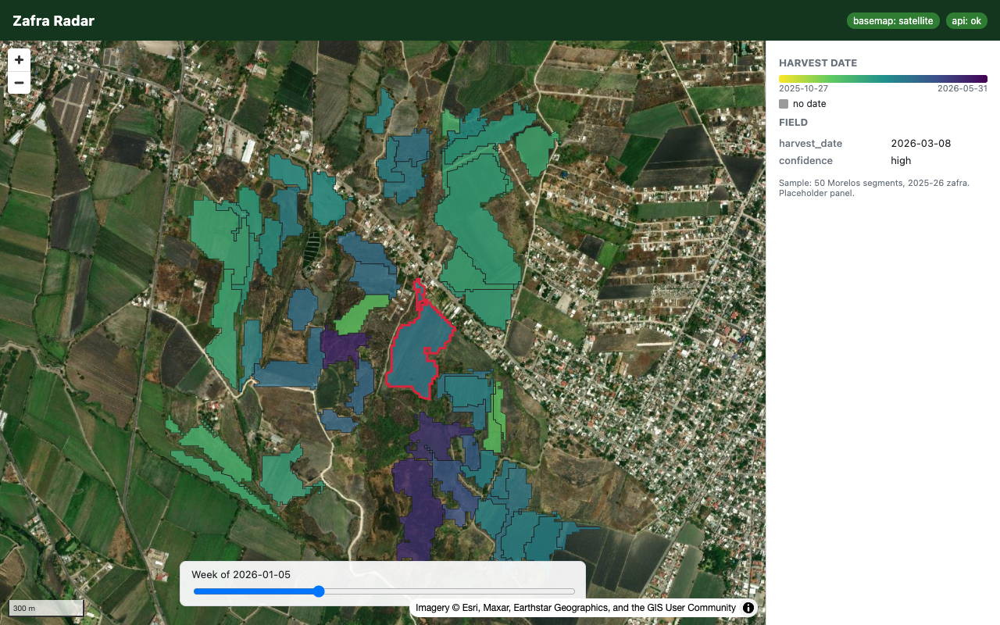

# Zafra Radar product (skeleton)

PostGIS 16 + FastAPI + React/MapLibre, started with one command. **Skeleton only** (exercise
7): the schema is empty, the API has `/health` and `/version`, and the map shows a bundled
sample of 50 Morelos segments (`web/public/sample.geojson`). Data loading and the real
endpoints are built during the hackathon: see [HACKATHON_PLAN.md](HACKATHON_PLAN.md).
Self-contained: nothing here imports `src/zafra`.

## Start / stop

```bash
cd product
cp .env.example .env          # optional: the defaults below are built in
docker compose up --build     # add -d --wait to run in the background until healthy
```

| Service | URL / port | Notes |
|---|---|---|
| web | http://localhost:5173 | Vite dev server, hot reload (source bind-mounted) |
| api | http://localhost:8010/health, `/version`, `/docs` | FastAPI, reload on save; also proxied at `/api` from the web app |
| db  | localhost:5434 (user/password/db from `.env`) | PostGIS 16-3.4, named volume `pgdata` |

```bash
docker compose down           # stop, keep the database volume
docker compose down -v        # stop and delete the database volume
```

The API container applies `api/app/schema.sql` on every start (idempotent `CREATE ... IF NOT
EXISTS`); `docker compose exec api python -m app.seed` reapplies it by hand.

## Offline

The stack needs the network only to **build** (base images, pip, npm). Once built, it
starts and the map renders with the Mac wifi off:

* the basemap (Esri World Imagery) is shown only if a probe tile loads; otherwise, or if
  tiles start failing, the map falls back to a plain background with the sample polygons
  ("basemap: offline (plain)" in the header). The style uses no fonts or sprites;
* to check that no container needs egress at runtime:

  ```bash
  docker compose -f docker-compose.yml -f docker-compose.offline.yml up -d --wait
  ```

  puts db/api/web on an `internal` network (no DNS, no internet). A small TCP forwarder
  (`gateway`) publishes ports 5173 and 8010, because Docker does not publish ports of
  containers on internal networks only.

## Notes

* `postgis/postgis:16-3.4` is published for amd64 only; on Apple Silicon it runs under
  emulation (`platform: linux/amd64` in compose). Fine for development.
* Headless check and screenshot: `cd scripts && npm install && node screenshot.mjs
  [--offline]` writes `docs/skeleton.png` and prints a JSON report (basemap state, API
  state, clicked polygon, console errors). `--offline` aborts every non-localhost request.
* Integration smoke test (from the repo root): `pytest -m integration
  tests/test_product_smoke.py`.

Measured on an M-series Mac (Docker 29.7, base images already pulled), 2026-10-27:

| | |
|---|---|
| Cold start, clean build (`down -v --rmi local`, builder cache pruned) to all healthy | 25 s |
| Start from built images | 12 s |
| Start with the offline override | 13 s |
| Map idle in headless Chromium (online / offline) | 2.7 s / 1.8 s |
| Images: api 309 MB, web 463 MB, postgis/postgis:16-3.4 853 MB | |


