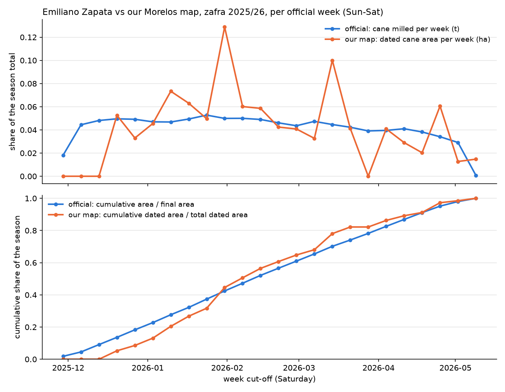

# Exercise 10: comparison with official CONADESUCA data, Ingenio Emiliano Zapata

Generated by `scripts/20_official_data.py`. Official data: CONADESUCA weekly progress
reports 1-36 and final report of zafra 2025/26 ([official_data.md](official_data.md),
[ez_final.json](ez_final.json), [ez_weekly.csv](ez_weekly.csv)). Our data: the Morelos
area-wide harvest map of exercise 4e (`data/results/harvest_dates_2025_26.geojson`,
[results/4e](../4e/area_summary.json)), unchanged.

**The AOI is not the mill's supply area.** Our map covers the FIRMS bbox
(lon -99.35 to -99.05, lat 18.50 to 18.75). The Ingenio Emiliano Zapata receives cane from its own
supply zone, which this bbox may cut or overshoot; cane inside the bbox may go to another
mill (Morelos has two: Emiliano Zapata and Central Casasano), and the mill's cane from outside the
bbox is not in our map. No parameter was changed to fit the official numbers.

## Parsing

36 of 36 weekly reports parsed; 34
carry a Emiliano Zapata row (reports 1-2 predate the mill's start on 27 Nov 2025). The weekly
series is the difference of the cumulative rows; it matches the reports' own weekly row to
within 1 ha and
1 t in every week.

## (a) Weekly timing

Official week = Sunday to Saturday cut-off. Detected tonnes = detected ha of the week ×
95.70 t/ha (official season field yield); a constant factor, so r
is the same as for hectares. Lag k pairs detection in week t with crushing in week t + k.

| lag (weeks) | Pearson r | weeks |
|---|---|---|
| -2 | 0.53 | 22 | context: detection after crushing |
| -1 | 0.60 | 23 | context: detection after crushing |
| +0 | 0.44 | 24 | |
| +1 | 0.27 | 23 | |
| +2 | -0.01 | 22 | |

## (b) Totals and dates

| quantity | official (final report) | our map |
|---|---|---|
| area | 9,565 ha harvested (*superficie industrializada*) | 9,943 ha gated as cane (104 % of official); 6,867 ha dated (72 %) |
| gated cane by status | – | dated 6,867 ha, no baseline 1,212 ha, not detected 1,863 ha |
| Morelos state (EZ + Casasano) | 15,787 ha | – |
| cane milled | 915,365 t (95.70 t/ha) | dated ha × 95.70 t/ha = 657,208 t |
| start | 2025-11-27 | first dated harvest 2025-12-20 (week of 2025-12-15 in results/4e) |
| end | 2026-05-03 | last dated harvest 2026-05-07 (week of 2026-05-04 in results/4e) |
| days | 158 real (146 in the 1st estimate) | 139 days first-to-last dated harvest |

Dated area outside the mill's season weeks: 0 ha.
results/4e/weekly.csv sums to 6,867 ha (same polygons,
Monday weeks).

## (c) Cumulative share of the season

Official share = cumulative ha / 9,565 ha; detected share = cumulative
dated ha / 6,867 ha.

| share reached | official (cut-off) | detected (cut-off) |
|---|---|---|
| 25 % | 2026-01-10 | 2026-01-17 |
| 50 % | 2026-02-14 | 2026-02-07 |
| 75 % | 2026-03-28 | 2026-03-14 |

| cut-off | report | official cane t | official ha | detected ha | detected t | official cum. share | detected cum. share |
|---|---|---|---|---|---|---|---|
| 2025-11-29 | 3 | 16,576 | 174 | 0 | 0 | 0.02 | 0.00 |
| 2025-12-06 | 4 | 40,688 | 260 | 0 | 0 | 0.05 | 0.00 |
| 2025-12-13 | 5 | 44,051 | 436 | 0 | 0 | 0.09 | 0.00 |
| 2025-12-20 | 6 | 45,378 | 432 | 361 | 34,578 | 0.14 | 0.05 |
| 2025-12-27 | 7 | 44,999 | 447 | 227 | 21,683 | 0.18 | 0.09 |
| 2026-01-03 | 8 | 42,977 | 429 | 312 | 29,899 | 0.23 | 0.13 |
| 2026-01-10 | 9 | 42,861 | 467 | 504 | 48,193 | 0.28 | 0.20 |
| 2026-01-17 | 10 | 45,205 | 436 | 433 | 41,412 | 0.32 | 0.27 |
| 2026-01-24 | 11 | 48,289 | 493 | 341 | 32,633 | 0.37 | 0.32 |
| 2026-01-31 | 12 | 45,703 | 485 | 884 | 84,628 | 0.42 | 0.45 |
| 2026-02-07 | 13 | 45,762 | 458 | 413 | 39,530 | 0.47 | 0.51 |
| 2026-02-14 | 14 | 44,853 | 467 | 402 | 38,497 | 0.52 | 0.56 |
| 2026-02-21 | 15 | 42,175 | 426 | 291 | 27,885 | 0.57 | 0.61 |
| 2026-02-28 | 16 | 39,893 | 423 | 280 | 26,808 | 0.61 | 0.65 |
| 2026-03-07 | 17 | 43,343 | 427 | 225 | 21,492 | 0.65 | 0.68 |
| 2026-03-14 | 18 | 40,863 | 452 | 687 | 65,759 | 0.70 | 0.78 |
| 2026-03-21 | 19 | 38,706 | 374 | 283 | 27,084 | 0.74 | 0.82 |
| 2026-03-28 | 20 | 35,810 | 394 | 0 | 0 | 0.78 | 0.82 |
| 2026-04-04 | 21 | 36,204 | 420 | 281 | 26,852 | 0.83 | 0.86 |
| 2026-04-11 | 22 | 37,536 | 409 | 199 | 19,085 | 0.87 | 0.89 |
| 2026-04-18 | 23 | 34,974 | 406 | 139 | 13,336 | 0.91 | 0.91 |
| 2026-04-25 | 24 | 31,207 | 385 | 416 | 39,783 | 0.95 | 0.97 |
| 2026-05-02 | 25 | 26,665 | 273 | 88 | 8,375 | 0.98 | 0.99 |
| 2026-05-09 | 26 | 647 | 192 | 101 | 9,696 | 1.00 | 1.00 |

## Read

**(a) The cumulative curves are the right comparison, and they agree.** The detected
share tracks the official share within -10 / +8
percentage points all season (behind at 2025-12-27, ahead at 2026-03-21). 50 % of the season is
reached on 2026-02-07 (detected) vs 2026-02-14 (official). The season
end agrees within 4 days (2026-05-07 vs 2026-05-03). The gated
cane area is 104 % of the official 9,565 ha
(9,943 ha). The AOI bbox is not the mill's supply area, so the area match shows the
two are of the same order, not that the cane gate is right.

**(b) Weekly r is weak (0.44 at lag 0) because of the sampling, not the dates.**
The mill crushes at a steady rate (coefficient of variation 0.13 over the 22
full weeks). Radar detections cluster on acquisition dates (0.69), so whole weeks
are empty or double. A week-to-week comparison penalizes the revisit schedule; the
cumulative curve in (a), which integrates over it, does not. Lags +1 and +2 (detection
leading crushing) give 0.27 and -0.01: not supported.

**(c) Lag -1 (r = 0.60) is in the expected direction.** A field is detected only
after the cut: the date is the midpoint between the last look classed standing and the first
look classed harvested (median gap 5 days between looks, both orbits).
On the 26 labelled fields these dates fall a median of +1.5 days after
the NDVI harvest-window midpoint (14 late, 8 early). The mill receives
cane within 72 hours of the cut (48 hours if burned; LDSCA art. 73). Crushing therefore
precedes our date by a few days, which pushes part of each week's detections into the
following week. A full week is more than this measured bias, so lag -1 was not the
pre-stated test and is not claimed as a result. It is consistent with the date rule,
not an anomaly.

Also:

- 3,076 ha of gated cane has no date (no baseline 1,212 ha, not
  detected 1,863 ha), so the dated area is 72 % of the
  official area. The mill had cut 870 ha (9 %) before our
  first date (2025-12-20, start 2025-11-27). That fits the detector
  needing a pre-harvest baseline, but this comparison does not prove it.
- Official data as printed: the last week (report 26) adds
  192 ha for 647 t, about
  3.4 t/ha. In report(s) 3, 25 a note says
  the mill's area was estimated by CONADESUCA, because the mill sent only a factory daily.
  Both are kept as published.
